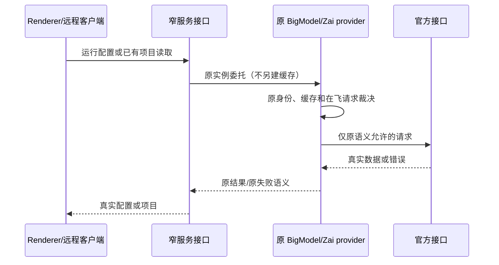

# 个人工作台后端保留能力契约附录

本附录细化已批准的 `2026-11-19-personal-workbench-commercial-services-design.md`，不改变范围决策。

## 服务接口与单一所有者

- `IRuntimeConfigService` / `runtimeConfigService` / RPC `runtime-config` 只暴露 `getDynamicWorkflowClientConfig(options?)`、`getModelContextBudgetStrategy()`、`getRequestVerificationConfig()`、`getForceUpdateConfig()`。
- `IAccountModelProjectsService` / `accountModelProjectsService` / RPC `account-model-projects` 只暴露 `getEnterprisePricing(request?)`，请求和响应复用现有 shared 类型。缺省 family 仍为 BigModel；Z.AI 使用原 Zai provider。保留原 authenticated 请求语义、账号变更防护、项目补全与必要项目 Key 准备。
- 一次 Host 装配仅创建原 BigModel/Zai provider 各一份。新接口和旧兼容接口引用同一实例；配置快照、TTL、in-flight、账号/endpoint 失效和迟到响应规则保持原实现。动态工作流用户设置仍由有设置权威的 Host 折叠，读取失败保持 disabled/default；预算兼容值不发网络请求。
- 新接口贯穿 services accessor/public exports、client proxy、desktop remote/source-settings 集合与 RPC 合同、web home-only fallback。未连接 attachment 的 Web fallback 明确不支持，不直连官方 HTTP。

## 退役接口

- 旧 Coding Plan 商业方法（商品/购买预览、Start Plan 领取预览、主动领取、折扣、支付、签约、订单、余额及交易操作）保留类型兼容时，一律 reject `Error("commercial_service_unsupported")`，不读取凭据、不创建 provider 请求、不返回空成功。
- 旧运行配置、已有账号项目读取的兼容别名委托同一新服务；OffPeak 配置不属于本附录的运行代码改动。
- Marketing query/report 明确 reject 同一错误；Host 不再装配营销资产授权来源，旧资源请求无法触发营销媒体或 bundle 下载。通用 cloud-content 服务保留其来源校验与拒绝语义。
- Usage Stats 的 reset status/opportunity/use/history-read 全部明确 reject 同一错误，停止额度重置机会与历史专用请求。App Usage、真实套餐用量、资格、普通 TPS 与合法额度查询保持原语义。
- `HighspeedCardService.prepareTurn` 先保留原自动化隔离、到期、身份及已有卡路径；没有当前有效卡时直接返回现有 `{ kind: "fallback", reason: "unavailable" }`，不启动 draw。已有卡 execution、healthy、归属隔离、请求鉴权及到期保持。不能把该 fallback 表述为抽卡成功，也不增发卡。

## 可重复验证

1. 使用合成 ApiClient（禁止真实账号/网络）、凭据读取器和隔离内存输入创建服务：旧商业、营销和 reset 每个方法均 reject；请求计数和凭据读取计数为零。
2. 并发经新接口及旧别名读取 config：原共享 in-flight 只产生一个请求；切换凭据不继承缓存；动态工作流失败仍关闭，预算不请求；forceRefresh 保持原行为。
3. 两个 family 的合成 Team pricing 验证原路由、响应和失败；不把失败改成空项目。项目 Key 准备沿现有实现执行。
4. 无卡 prepareTurn 的 draw/鉴权门禁计数为零；合成已有卡验证原 execution 和到期，healthy 仍检查 owner。相关 App 行为不新增业务单测；使用一次性离线运行时验证与现有工程边界门禁，E2E 由主线程维护。
5. 运行 types、lint、architecture；本附录不宣称尚未执行的多进程 E2E 或真实账号验收通过。

## 旧 Host 安全兼容

新窄客户端读取沿旧 subscription RPC 的原保留方法委托，避免新频道在旧 Host 上超时；交易、reset 与 marketing 在客户端本地明确拒绝。Highspeed 新增可选 `prepareExistingTurn(params)`，语义为仅使用现有有效卡、绝不 draw。新客户端的 prepareTurn 只调用此方法，旧 Host 返回 Method not found 时明确降级 unavailable，不回退旧 prepareTurn（先读取快照仍存在过期后触发 draw 的竞态）。已有 CLI execution、healthy、getSnapshot、归属和到期路径保留。
