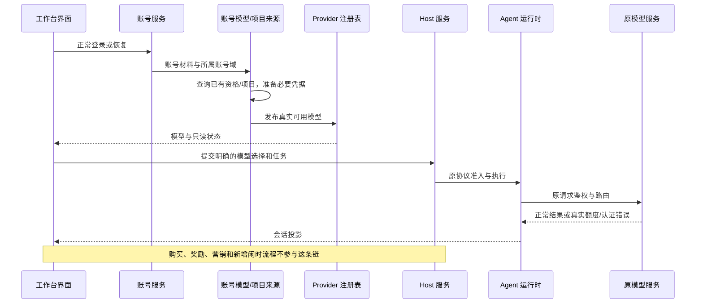
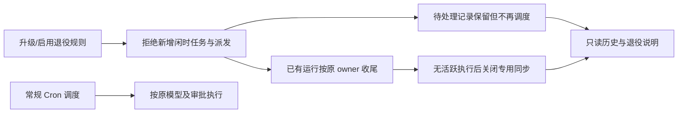

# 个人工作台：保留账号模型的商业服务拆除设计

- 日期：2026-11-19
- 基线：ZCode v3.18.2
状态：用户已批准；实施中。产品边界、阶段顺序、保留能力和验收规则冻结，具体文件内接口拆分按下方契约建议执行。

## 1. 已确认的目标

用户要求先保留官方账号登录，准备移除交易、营销、云权益等商业云服务。经明确选择，继续使用账号已有套餐合法提供的模型，并保留必要的凭据与可用性校验；移除购买、续订、促销、奖励、免费额度领取、闲时票据等入口及后台调用。

这里的“云权益拆除”限定为增发、领取、促销及闲时权益流程。服务端决定的合法模型资格、已有额度及请求认证继续有效。不能将账号模型改成默认有权限，也不能在官方接口失败时伪造无限额度。

本轮在 `refactor/personal-workbench-commercial-services` 实施已批准范围，先完成非交易能力拆分，再退役交易/营销/主动获取及闲时新增能力，最后验收。保留既有 OAuth、配置、任务/会话和索引存储，不访问或修改真实账号配置与数据库，不启动用户生产应用，不提交或推送代码。

## 2. 范围决策

| 领域                                                     | 本轮目标                           | 原因                                           |
| -------------------------------------------------------- | ---------------------------------- | ---------------------------------------------- |
| 官方登录、账号恢复、信息、切换、退出                     | 保留                               | 用户明确要求；账号仍支持已有模型               |
| 个人/团队套餐的模型资格、项目发现、必要项目 API Key 准备 | 保留                               | 正常使用已有套餐的前置条件                     |
| 当前套餐/额度只读状态、真实拒绝原因                      | 保留，去除购买及领取动作           | 保证额度耗尽、过期和请求失败可解释             |
| 自定义 Provider、API Key、模型默认值                     | 保留                               | 个人模型接入继续可用                           |
| 购买、升级、续订、支付方式管理、订单、充值跳转           | 移除应用入口和专用后台调用         | 不再在应用里办理商业交易                       |
| 奖励中心、邀请、营销 Banner/弹窗、促销上报               | 移除                               | 停止获取配置、拉资源和营销事件上报             |
| 免费额度主动领取、额度重置机会/操作、抽卡/分享获益入口   | 移除新操作及其轮询                 | 与保留既有合法权益区分                         |
| 已发放 Start Plan 或已激活高速卡等模型权限               | 保留真实使用及到期判断；不新增领取 | 不回收用户已有权益，不把去营销做成修改模型鉴权 |
| Off-Peak 闲时任务                                        | 退役创建、取号、轮询及新派发       | 依赖云票据，不属于常规本地调度                 |
| 本地 Cron、动态工作流、Subagent、会话历史、App Usage     | 保留                               | 核心工作台能力；必须从混合依赖中分离           |
| 云分享、手机远控、SSH/WSL、插件市场、更新、通用遥测      | 本轮不改                           | 不因“云”字扩大到所有网络服务                   |
| 模型端点路由、工具审批、MCP OAuth、SSH/Web 访问认证      | 本轮不改                           | 与交易和营销生命周期分开                       |
| 现有商业订阅本身、云端排队记录                           | 不自动取消、退订、退款或删除       | 本地裁剪不代表对外操作授权                     |

已有付费订阅可能继续在服务端续费；删除应用入口不会取消订阅。实施说明必须明确这一点，应用不得自动执行退订等外部动作。

## 3. 方案选择

推荐按依赖拆分：先保留公共运行配置和账号只读能力，再移除交易及营销调用，最后退役闲时调度并清理死代码。只隐藏入口会残留后台请求；整块删除订阅服务会破坏公共配置和团队模型发现。无需新增“假登录”或“全权益”模式，也不需要另建一套会话数据。

变更层级涉及 presentation、validation、commit-effect、option-source，以及 Off-Peak 的 persistence/recovery。账号模型资格的权威方保持为官方服务，配置服务持有 Provider 配置，Host 装配服务和调度器，CLI 持有执行与会话事实，Renderer 只展示状态和提交操作。

## 4. UI Surface Matrix

| 场景/入口              | 共享实现与状态                                 | 当前提交/权威                              | 拆除后的行为                                                      | 平台/隔离要求                              |
| ---------------------- | ---------------------------------------------- | ------------------------------------------ | ----------------------------------------------------------------- | ------------------------------------------ |
| 登录与账号切换         | Root、OAuth 状态与账号缓存                     | OAuth/账号服务                             | 登录、切换、退出及原错误提示保留；不触发奖励或购买续接            | Desktop、普通 Web、手机入口不混为一套门禁  |
| 设置的模型与套餐页     | model-provider-section、账号模型投影           | Provider 配置；账号服务；企业项目读取      | 保留连接、已有个人/团队模型及额度；移除购买 WebView/升级/支付按钮 | API Key 配置不能跟随账号退出被删除         |
| 侧栏、头像菜单、用量页 | sidebar-activity、Usage UI                     | usage-stats；营销/领取服务                 | 只读用量和账号状态保留；购买、领取、邀请、抽卡入口移除            | 不移除本地 App Usage 数据                  |
| 根营销与奖励弹窗       | Root 的 MarketingTouchProvider/RewardsProvider | 营销配置、资源下载、事件上报；奖励 WebView | 停止挂载及生命周期请求，移除入口与专用凭据桥接                    | 通用浏览器/WebView 与登录回调继续可用      |
| 对话输入与模型菜单     | SessionPane、Provider 选择、高速卡入口         | 账号合法资格、会话选择、CLI 请求认证       | 移除新增促销领取，已有合法选择和到期语义保留                      | 不静默换模型、不重发旧消息、不改变队列准入 |
| 自动化页、OffPeak 工具 | OffPeakTaskStore/Service、调度进程             | tasks-index 与云票据；CLI 当前执行         | 不再创建、取号或派发；历史可解释，已运行任务按迁移规则收尾        | 普通 Cron 与动态工作流不受影响             |

共享的 Provider 菜单不代表共享持久化：会话模型、自动化模型、Subagent 模型及全局默认值分别保存，不能用一次全局替换覆盖全部来源。

## 5. 关键依赖与处置

### 5.1 订阅服务不能整体删除（must-inspect）

`packages/services/src/coding-plan-subscription/codingPlanSubscriptionService.ts:46` 同时暴露交易和非交易方法。`getDynamicWorkflowClientConfig`、`getModelContextBudgetStrategy`、`getRequestVerificationConfig`、`getForceUpdateConfig` 是运行/请求配置，不能因服务名称带 subscription 就删除。

目标接口分为三种职责：

1. 运行配置读取：保留现有缓存、失败语义、用户设置覆盖与 Host 裁决；先与交易接口解耦，本轮不另造官方配置的本地真值。
2. 账号模型与项目读取：保留个人/团队资格、已订阅项目上下文及必要凭据准备；不伪装成交易删除。
3. 商业动作：购买、订单、支付、领取、营销等，在调用方退役后删除其实现与接线。

先迁移消费者，再撤销注册和公共导出。实施时按架构 context 冻结实际接口名称与模块归属，避免在准备文档中假定不存在的 API 已可用。

证据：`packages/ui/src/Root.tsx:270`、`packages/ui/src/hooks/useDynamicWorkflowAvailability.ts:27`、`packages/ui/src/store/dynamicWorkflowAvailabilityStore.ts:57`。动态工作流配置由 Host 决策；UI 仅缓存，读取失败仍按现有策略处理。

### 5.2 企业 pricing 包含已有账号模型能力（must-inspect）

`packages/ui/src/root/oauthTeamPricing.ts:9` 在登录后调用 `getEnterprisePricing`。该调用失败与成功空列表有不同含义，不得用空列表吞掉网络失败并清除原选择。

`packages/services/src/coding-plan-subscription/bigmodelCodingPlanSubscriptionProvider.ts:934`、`:991` 调用 `ensureSubscribedTeamPlanProjectApiKeys`。因此 pricing 接口即使返回商品字段，也不能一概列入禁止请求清单。第一阶段保留该请求所需的项目发现和凭据准备，去除购买消费者；不承诺未经服务端支持就消除该共享请求。Z.AI/BigModel 两个账号域分别验证。

### 5.3 购买 WebView 与营销生命周期（must-inspect）

实际购买入口包括 `packages/ui/src/settings/CodingPlanEmbeddedWebviewDialog.tsx`、`CodingPlanUpgradeDialog.tsx` 及 `model-provider-section/codingPlanEmbeddedWebview.ts`；不能只删除旧支付面板。购买恢复状态和深链必须一起收口，保留通用外部浏览器与 OAuth 回调。

`packages/ui/src/Root.tsx:184` 挂载 Rewards 与 Marketing。删除视觉入口后仍要停掉配置加载、资源缓存刷新、任务完成触发及确认/取消上报。旧购买/奖励链接在新版给出“此入口已移除”，不得再注入凭据或打开购买页面。

### 5.4 保留额度读取，移除促销操作（should-inspect）

`packages/services/src/usage-stats/usageStatsService.ts:83` 将 App Usage 与 Coding Plan 用量分开。保留两者的真实只读数据及错误状态；删除购买/领取/重置机会等动作不能清空本地统计或改变服务端实际额度。

检查 `packages/ui/src/components/coding-plan-quota-reset/`、`packages/ui/src/sidebar-activity/`、`packages/ui/src/highspeed/` 与 `packages/services/src/highspeed/`。对高速卡只拆“取得新权益/促销分享”的流程；已有卡的合法使用、请求凭据、到期和历史展示仍受原合同约束，不能全目录删除。

### 5.5 Off-Peak 与 Cron 共享调度资源（must-inspect）

`packages/desktop/src/main/desktopCronScheduler.ts:25`、`:166` 包含 Off-Peak 消息转发；`docs/task/task-sqlite-index.md:13` 说明任务、Automation 和 Off-Peak 共用索引库。不得删除整个 scheduler、tasks-index、自动化服务或 CLI CommandInbox。

退役设计规则：

- 首先关闭新 OffPeak 创建、取号、重新提交和新派发，包括模型可见工具及服务直接入口。
- 旧 pending/queued 记录保留历史，标记为本地“该能力已退役、不再派发”。展示的云端状态仅说明最后观测时间，不宣称云端已取消。
- 已经 running 的执行沿原 owner 完成/失败/用户取消；只允许该执行收尾所必需的交互，不再接纳下一项。待旧执行归零后，才能完全停止专用轮询和移除其执行通道。
- 不能把旧闲时任务自动转换为会消耗正常模型额度的 Cron 或立即任务。
- 完整重启后不得自动重放旧票据或把不确定结果标为成功。重复迁移幂等，保留原任务与执行标识。
- 不删除用户数据；不自动向云端发取消、退订或其他外部写操作。

仅保留既有运行任务收尾所需的有限过渡请求；最终验收需证明零活跃闲时执行后专用网络请求归零。

### 5.6 已接受的最小实施契约

以下名称是本轮拆分目标，不代表基线已经提供这些接口。实现单元如需调整名称，必须在更新本节并通知消费者后调整，不改变职责、来源或请求语义。

| 服务面                                                         | 最小接口建议                                                                                                                                         | 唯一所有者及约束                                                                                                                                                                       |
| -------------------------------------------------------------- | ---------------------------------------------------------------------------------------------------------------------------------------------------- | -------------------------------------------------------------------------------------------------------------------------------------------------------------------------------------- |
| `runtimeConfigService` / `IRuntimeConfigService`               | 原签名保留 `getDynamicWorkflowClientConfig(options?)`、`getModelContextBudgetStrategy()`、`getRequestVerificationConfig()`、`getForceUpdateConfig()` | Host 装配唯一运行配置读取实例。迁移原缓存、in-flight 去重、forceRefresh 和失败语义；动态工作流用户覆盖仍由 Host 折叠，UI 只读。context-budget 继续固定 `preflight-v1`，不新增请求。    |
| `accountModelProjectsService` / `IAccountModelProjectsService` | `getEnterprisePricing(request?: EnterpriseCodingPlanPricingRequest): Promise<EnterpriseCodingPlanPricingResponse>`                                   | 保留原方法名与返回结构，明确它承载已订阅 Team Plan 的项目发现与必要 API Key 准备。family 缺省行为及 BigModel/Z.AI 分流不变；不得创建一份独立凭据或伪造空成功。                         |
| `usageStatsService`                                            | 保留 App Usage、Coding Plan 用量、已有权益与 TPS 只读方法                                                                                            | 原服务与真实账号/本地数据仍是来源。重置机会、使用重置、领取等专用动作和轮询退出契约。                                                                                                  |
| `highspeedCardService`                                         | 保留已激活卡的准备使用、owner 校验、状态/历史读取、失效与到期处理                                                                                    | `prepareTurn` 内的新 draw 与 transport.draw 是实际新增权益边界，必须停止；不能因删除抽卡 UI 而保留自动抽卡。既有 `prepareWithCard`、鉴权和到期规则保持。历史卡快照不等于当前可用权限。 |
| `offPeakTaskService`                                           | 保留本地 `list/get`、旧结果展示及既有执行收尾；新创建、取号、继续/重提明确拒绝                                                                       | service admission、Host dispatch 和 CLI capability 都需退役，不能只改配置灰度。原 Repo/执行 owner 继续持有原记录与结果。                                                               |

运行配置拆分不要直接替换为现有 `IClientConfigService.getSnapshot()`：基线存在另一套公开配置快照接口，当前读取形式与订阅 Provider 内的运行配置 envelope 不同，未经等价验证不能混用。A 阶段可以让新服务面暂时委托同一实例以保留缓存；B 阶段必须移除该实例中的商业动作和外部暴露，不能将整个旧交易服务藏在新名称后长期保留。

账号项目读取失败与成功空列表的区别贯穿 UI。`oauthTeamPricing.ts` 已有带 `status` 的结果；`getEnterprisePricingProductsOrEmpty` 的调用者也必须保留失败时的原选择，不得因便捷包装丢失错误语义。模型设置中的 `useEnterpriseCodingPlanProducts` 在购买消费者退出后仍承担已订阅团队展示，其实时项目读取保留；公开静态商品目录不再是账号模型准入前提。

最小 OffPeak 迁移不要求新增数据库列或重写旧 `status`。退役是本地固定能力规则：queued/paused 记录按原字段保存，列表显示“能力已退役，不再派发”，`schedulable` 的展示/派发结果为 false，不能把它写成云端 cancelled。若实现确需加列，必须先单独补 schema 合同、幂等迁移和逐表哈希验收，不能改变既有列含义。

既有 running 必须由原 owner/lease 与实际在途执行共同确认；数据库的一条 `running` 记录本身不能授权重放。完整重启时无可确认 owner 的旧记录保留历史与未知结局，不重新执行、不标成功。有限收尾仅可处理已确认运行实例的终态、取消及原生命周期必要交互；不能扫描全部历史终态 outbox 后批量请求，也不能为 queued/paused 批量轮询。归零后定时器和专用请求都停止，普通 Cron 调度继续。

架构上下文核对结果：`services`、`ui`、`session` 均是 unmanaged 祖先模块；不能把 `architecture:context` 成功当作这些目录已受管。新增源码须先按最小职责注册 managed 模块与公开入口；本节不授权扩大为整个 UI/services/session 的模块接管。公共接线文件由 A 单一实现者改写，C 将其接线需求交给 A，防止并发覆盖。

## 6. 所有者与事件顺序

始终保留 workspaceIdentity 与 remoteSessionId 的隔离、desktop-continuous / web-remote-replayable 的不同恢复语义，以及 CLI 作为已接受输入唯一 owner 的约束。

## 7. 接口、请求与持久化验收边界

| 类别     | 规则                                                                                                 |
| -------- | ---------------------------------------------------------------------------------------------------- |
| 允许     | OAuth、账号信息、已有套餐/项目发现、合法额度、必要凭据、已激活模型权限、模型推理、保留能力的运行配置 |
| 禁止新增 | 购买预览/下单/续订/支付方式操作、促销配置/资源/事件、奖励领取、额度重置机会与提交、闲时取号/派发     |
| 有限兼容 | 已运行闲时执行的必要收尾；之后专用请求必须停止                                                       |
| 共享接口 | `getEnterprisePricing` 等按消费者和目的审查，不根据 URL 单词或方法名粗暴封禁                         |
| 旧状态   | 不清空 OAuth、个人模型配置、任务/会话、Cron、MCP 或 SSH 凭据；不回收已有服务端权益                   |

只允许在文档中记录路由/方法与合成标识。验收日志不包含真实 token、API Key、用户内容或内部地址。网络证据覆盖 Renderer、Host、CLI 与调度进程，单看浏览器 Network 面板不足以证明请求停止。

## 8. 候选验收用例与覆盖计划

以下是与已确认边界一致的验收设计，状态均为 planned；尚未执行，不宣称现有测试已覆盖个人版。

| ID    | 前置与操作                                                 | 必须断言                                                       | 证据                                    |
| ----- | ---------------------------------------------------------- | -------------------------------------------------------------- | --------------------------------------- |
| PCS01 | 干净目录，登录任一官方账号；重启；退出                     | 账号恢复/退出行为正常；无购买、营销、奖励请求                  | Desktop UI、Host 请求计数、凭据状态摘要 |
| PCS02 | 账号已有个人套餐，选择模型并调用工具                       | 原模型与认证正确；任务持久化、重启续聊有效                     | UI、CLI 请求、会话记录                  |
| PCS03 | 已订阅 Team Plan，刷新并切换项目；分别注入读取失败和空列表 | 项目发现与必要 Key 准备正常；失败不误清选择；无购买动作        | 两个账号域的合成夹具、UI、服务请求      |
| PCS04 | 无套餐/套餐过期/额度耗尽/认证过期                          | 展示真实不可用原因，不伪造资格、不跳购买；可选自有模型         | UI、请求失败投影、Registry              |
| PCS05 | 匿名配置个人 Provider，发消息、重启                        | 自定义配置和默认模型保留，无官方账号前置                       | UI、合成模型端点、文件/会话摘要         |
| PCS06 | 启动、打开设置/用量页、完成任务、空闲跨过刷新周期          | 无购买/促销/领取入口及专用请求；本地用量和账号额度可读         | 多进程请求记录、UI；不能仅测初次渲染    |
| PCS07 | 旧购买/奖励深链或已存打开状态                              | 不打开购买页面、不注入其凭据、不恢复购买流程                   | UI 与 WebView/请求记录                  |
| PCS08 | 历史 Start Plan/已激活高速卡及普通套餐                     | 旧合法模型资格保留，到期按真实规则处理；无新增抽卡/领取        | UI、模型认证、历史显示                  |
| PCS09 | 旧 idle queued + running；启用退役规则；再重启             | queued 不派发；running 按原 owner 收尾；历史保留；不转付费任务 | 调度/CLI 事件、SQLite 摘要、请求计数    |
| PCS10 | 退役 OffPeak 后创建并执行普通 Cron/动态工作流              | 原选模、调度、审批及历史正常                                   | UI、调度与 CLI 事件                     |
| PCS11 | 普通 Web、手机远控、SSH 工作区登录后使用既有模型           | 保留能力可连接；无已移除服务的 RPC 调用；身份不串线            | 代表性平台运行验收、RPC、远端身份       |
| PCS12 | API/RPC 直接调用已退役商业/闲时操作                        | 返回明确不支持或方法已移除；不发云请求、不建本地任务           | 服务/CLI 工程边界测试与网络记录         |

优先采用高风险组合：账号状态 × 模型类型、Team Plan × 网络失败、闲时状态 × 重启、平台 × RPC 契约。不展开全部主题/语言/账号/模型的笛卡尔积；共享界面的桌面和手机布局、至少中英文仍做代表性检查。

App 不新增或恢复业务单测。先维护相关 E2E 规格与覆盖矩阵，再动交互实现；CLI/CUA/工程边界变更按自身入口补回归。现有参考包括 `packages/desktop/test/e2e/settings/providers/coding-plan-entitlement-presentation.test.ts`、`packages/desktop/test/e2e/ui-shell/marketing/`、`packages/desktop/test/e2e/conversation-session/entitlements/` 及 `automations/conversation-session-offpeak-*.test.ts`。退役测试不能直接改名当成验收通过，先增加替代断言，再清理仅验证旧商业行为的用例。

## 9. 发现方法、图谱与交接

本轮复用前次静态扫描，补查订阅服务消费者、企业 pricing 与购买 WebView、共享闲时调度。当前工具未提供 codegraph，未生成静态调用图完整性证明；以定向 rg 与源码 Read 核对关键直接调用，不能据此宣称已找到全部调用方。

功能图已有 plan-entitlements、marketing-touch、OAuth attribution 等节点；实施收口时增加“保留账号模型的商业功能退役”能力，关联账号项目读取、运行配置、购买 WebView、OffPeak 调度与已有权益兼容。仅在各阶段真实调用图和验证结果核对后更新；不能把尚未完成的接口或计划用例写成现有产品事实。

产品边界已经批准。实现中的接口命名、模块登记与迁移细化以 §5.6 为准；这不授权新增云服务、移除账号模型、取消订阅或清理用户数据。运行验收状态仍按实际执行更新。

执行顺序、文件所有权与门禁见 [拆除实施计划](../plans/2026-11-19-personal-workbench-commercial-services.md)。
