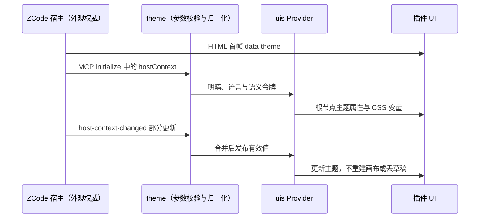

# ZCode 仓库内插件工程化设计

**状态：** 架构已确认；本文中的路径、构建和验收均为目标契约，不代表两个新应用已经完成或安装。

## 1. 布局与范围

```text
plugins/                         # 独立 pnpm workspace，不改主仓库成员或锁文件
  apps/
    genimage/                    # 新 React 画布 + Node stdio MCP 应用
    nextstep/                    # 新 Node 扩展，无独立 UI
  packages/
    theme/                       # 宿主外观参数适配
    ui/                          # 仅 shadcn CLI 生成的元组件及其工具
    uis/                         # 唯一公共组件 API 与主题接入
  legacy/
    genimage-dev/
    nextstep/
    marketplace.json
  package.json
  pnpm-workspace.yaml
  pnpm-lock.yaml
```

工作区成员仅匹配 `apps/*` 和 `packages/*`。旧实现及其市场清单作为一组归档，保留相对路径，不加入工作区，也不作为新包的构建或运行依赖。新应用在自己的目录中建立，以旧规格、代码和回归证据为参考，不把旧工程搬进 `apps/` 原地改造。归档后旧市场的相对结构仍完整，但宿主保存的绝对来源不会自动改变。对应新应用完成且验收通过后，另行确认要移除的旧实现，不能提前删。通用插件创建器的默认布局不变。

本轮 GenImage 仍是无计费的示例画布；不新增生成供应商、持久图库或付费工具。NextStep 仍由宿主渲染轮尾，不改扩展、SQLite 和并发契约。其他公共包按实际复用需求建立。

## 2. 工具链与依赖约束

开发 Node/pnpm 对齐仓库 `mise.toml`。React、Vite、Tailwind CSS v4、shadcn CLI、TypeScript、类型感知 Oxlint、MCP SDK 与构建工具选实施时兼容的最新稳定版。所有第三方直接依赖（包括开发工具与 peer 声明）由独立 `pnpm-workspace.yaml` 的精确 `catalog` 锁定；包清单用 `catalog:`，内部依赖用 `workspace:`，冻结锁文件安装。严格目录模式之外检查包清单，拒绝显式版本绕过。

新代码使用严格 TS，启用 `strict`、`noUncheckedIndexedAccess`、`exactOptionalPropertyTypes`。浏览器端和 Node 端分别配置类型环境。lint 禁止不安全类型、未处理 Promise、错误的 React Hooks 调用或依赖。CLI 生成代码仍要能通过类型检查；手写代码的 lint 约束不能通过手改生成代码或扩大规则豁免规避。

```text
应用及业务层 ──→ uis ──→ ui
                    └──→ theme ←── 宿主公开参数
```

- **`ui`**：包含 shadcn CLI 配置、组件清单和生成的元组件及内部工具。仅通过固定版本 CLI 拉取或更新；禁止手改。只有 `uis` 可以声明 `ui` 依赖并通过它的公开入口导入。
- **`theme`**：集中校验、合并和归一化宿主公开外观参数，输出类型化外观和语义令牌。不依赖 React 或组件，不保存用户主题偏好，不回写宿主。
- **`uis`**：不需适配的元组件再导出，其余在此包装。公共 Provider 和 Tailwind v4 语义变量将 `theme` 的输出应用到应用根及所需浮层。公开样式同时在这些作用域内声明业务 CSS 可读取的语义颜色变量，不依赖 Tailwind 是否生成同名 utility；离开作用域不污染宿主或相邻界面。包装组件的语义字号不应覆盖生成元组件的前景色。应用和业务只能通过 `uis` 的公开入口使用组件，不自行实现主题桥接。无独立 UI 的 NextStep 不依赖这三个包。
- 依赖门禁检查 manifest 及源码，覆盖包名、深层路径、相对路径和别名；拒绝从其他包直达 `ui`，亦不允许公共包引用应用、旧实现或宿主私有源码。

## 3. 主题所有权与更新时序



以 `buildPluginUiHostContext.ts` 和 `pluginUiStyleVariables.ts` 实际提供的公开字段为准，消费 `theme`、`styles.variables` 及受支持的语言、安全区和展示上下文。首帧尊重宿主注入的 `data-theme`；初始化成功后以宿主为准。样式采用明确白名单及值校验，缺失或不合法的字段走有界语义默认；不把任意 CSS、外链字体或新增权限带入沙箱。独立开发预览可注入模拟宿主，不在生产沙箱保留与宿主竞争的主题开关。画布与草稿状态归 GenImage，不归主题 Provider；NextStep 数据仍由其 SQLite worker 持有。Web 预览不等于生产 Web/手机端拥有插件宿主。

## 4. 构建与市场交付

每个应用自产 `dist/market/marketplace.json`（手动登记的市场根）、`dist/market/<plugin>/.zcode-plugin/plugin.json` 和该插件运行所需的 `dist/` 文件。共享包随目标产物打包。GenImage 输出 stdio ESM 服务和自包含的画布 HTML，保留 `ui://genimage/canvas.html`；NextStep 输出 ESM 扩展和独立 SQLite worker，保留运行时相对关系及 Node 内建依赖。先构建到临时目录，验证清单、版本、资源和依赖闭包后替换产物；若目录布局和文件字节完全相同，保留原目录，不进行无效替换。失败不发布半成品。生成目录不入 Git，不含开发源码、`node_modules`、符号链接或另一插件文件。

宿主复制整个市场目录作快照，再单独复制选中的插件目录；不会运行构建或包管理器。不得将开发树用作新市场产物。市场与插件名称分别保留 `genimage@genimage-local` 和 `nextstep@dev-zcode-1b53af4a`，manifest 与 listing 同步升版。新路径由用户显式选择；先在隔离配置验证同身份换址及升级，确认数据及启用状态，再给出手动迁移指引。不自动改用户来源、缓存或卸载插件。

## 5. 验收与退役条件

| 项目 | 验收证据 |
| --- | --- |
| 工作区 | 冻结安装、catalog 和依赖边界检查、严格 typecheck、lint、build；禁止越层导入的负例能失败，CLI 元组件无手改。 |
| GenImage | 对脱离源码树的产物做 stdio MCP 冒烟，验证 `open_canvas`、`brief`、资源 URI/HTML 和错误行为；以浏览器及 Desktop 分别验证首帧、主题切换、无效输入回退、画布/草稿保留、键盘与窄宽布局。无全局 Node 的 Desktop 安装单独记录结果。 |
| NextStep | 用既有规格和回归场景验证构建入口、SQLite 版本/旧数据、并发幂等、崩溃及 owner fence；既有桌面轮尾用例指向新产物。inline 测试不替代市场安装。 |
| 发布与兼容 | 在隔离环境从两个干净市场独立安装、启动及同 ID 更新。运行仓库 typecheck、lint、架构门禁并报告实际结果；未跑的桌面验收不算通过。 |

通过对应 app 的回归和市场交付检查后，方可提出移除该 app 的旧实现；其余旧目录和相关市场条目不受影响。
