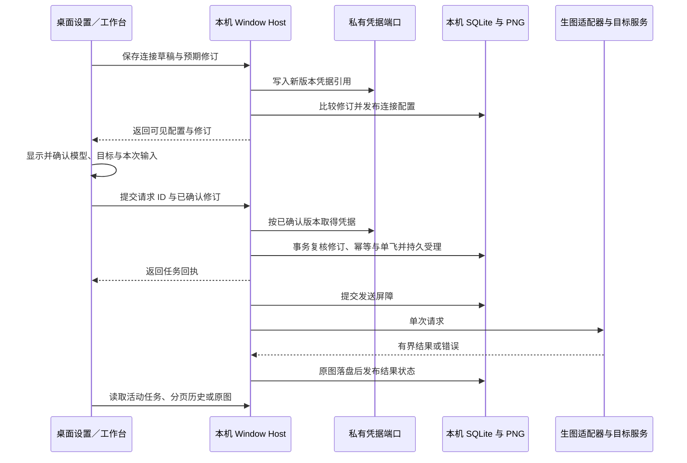

# 内置生图工作台与模型设置设计

日期 2026-11-25 · 评审稿 · 基线 `develop` / `f5c58fdb`

本文供产品和技术评审。确认后更新生图、模型设置与相关验收规格，再开始实现。实际工具清单、协议支持和第三方联调结果以具名验收证据为准。

## 1. 产品目标与交付范围

| 用户要求               | 设计决策                                                                                                                                                                                   |
| ---------------------- | ------------------------------------------------------------------------------------------------------------------------------------------------------------------------------------------ |
| 生图成为内置功能       | 桌面左栏保留「生图」，中央主区原生渲染。全新安装、未安装插件、无选中会话都可以打开。任务、密钥、图库与导出继续使用本机 Host。                                                              |
| 把生图模型并入模型配置 | 按截图移除模型设置顶部的独立密钥卡，在双栏左列增加独立「生图」和「小工具」分组，详情显示在右列。                                                                                           |
| 完善生图配置           | 支持多个连接、每连接多个模型、默认模型和单次临时选择。配置显示名称、协议、Base URL、请求路径、鉴权、API Key、模型 ID、已支持的生成参数。提供连接验证、真实试生图、最近测试结果和错误定位。 |
| 给小工具指定模型       | 推荐首批接入已有的「自动标题」和「Git 提交说明」。每个工具独立绑定一个文本模型，默认沿用当前行为。先在本机桌面、本机工作区交付由此页面设置的覆盖。                                         |
| FrostFox 联调          | 完成原生迁移与本地夹具验收后，阅读用户提供的 [FrostFox Keys](https://market.frostfox.ai/keys) 及页面链接的生图文档，根据文档填配置并尝试对接。                                             |

架构结论：模型设置共享导航、表单与反馈组件。生图连接和模型由本机生图服务持有，小工具保存现有文本模型的引用，聊天连接继续由现有 Provider 配置管理。把图像输出扩进通用聊天 Provider Registry 会同时扩大聊天候选、官方套餐和远端下发的范围，首版采用独立生图配置。将旧页打包为随应用分发的插件仍依赖扩展加载与沙箱桥，原生工作台直接复用现有 Host 服务。

首版生图范围为单张文生图、图库、预览、导出和连接／模型配置。改图、批量、Agent 付费调用、自动重试和跨设备图库同步留作独立需求。普通 Web 与手机远控沿用当前生图能力范围，入口和 RPC 均按客户端真实能力提供。桌面选择 SSH、WSL、Docker 或 Source 工作区时，生图仍用本机 Host，页面标注「本机图库」。小工具覆盖的执行范围单独判断，详见第 6 节。

**当前事实。** 桌面入口与 `genimage` 主区已存在，插件提供应用级沙箱画布和旧会话模拟画布。真实生图在宿主使用固定 OpenAI Images、`gpt-image-1`、独立密钥和本机 SQLite，历史投影最近 24 条。现有聊天模型 `supportsImage` 表示图像**输入**能力。现有聊天连通性测试解析已保存模型并走目标 Environment 的正式模型执行，生图测试另用图像协议适配器。[应用级生图规格](2026-11-23-genimage-plugin-design.md#应用级首版2026-11-24) · [服务契约](../../../packages/services/src/image-generation/CONTRACT.md) · [模型双栏规格](../../ui/settings-model-provider-two-column-layout.md) · [聊天模型测试](../../../packages/services/src/model-provider/providerSettingsConnectivity.ts) · [模型能力](../../../packages/shared/src/model-config.ts)

## 2. 页面与交互

```text
模型设置
┌─────────────────┬────────────────────────────────────────┐
│ 智谱 / 账户连接   │ 生图                              ＋添加连接 │
│  BigModel       │ [连接 1 ▾] 启用 · 已配置密钥                 │
│ 自定义供应商      │ 协议 / Base URL / 生成路径 / API Key         │
│  …              │ [验证连接] [保存]                            │
│ 生图             │ 模型列表                     ＋添加生图模型   │
│  生图连接        │ [默认] 模型一 [编辑] [试生成一张]             │
│ 小工具           │ 模型二       [编辑] [试生成一张]              │
│  工具模型        │ 最近结果、耗时与可操作的错误                   │
└─────────────────┴────────────────────────────────────────┘
```

- 左侧新增两个具名分组，每组先提供一个可选入口「生图连接」「工具模型」。模型设置沿用 `selectedNodeKey` 单一选中源，节点类型区分聊天供应商与工具页面。生图连接列表在右侧管理，供应商拖拽与权益卡只作用于原有节点。右侧页头的添加与刷新按当前节点切换语义。直接进入模型设置保持原有初始选中，从工作台「配置生图模型」直达「生图连接」，退出设置返回生图。
- 沿用外层设置页面滚动、224px／56px 导航、宿主选中样式、`text-ui-*` 和语义色。紧凑导航有图标、可访问名称和键盘焦点提示。长 URL、模型 ID 和错误文本可换行，窄屏操作区换行。离开有未保存变更的详情时提供继续编辑或放弃，清空已放弃的密钥输入。
- 桌面工作台统一使用一层宿主页头，包含历史、模型设置、主操作「新建生成」及平台所需窗口控制。宽主区保留画布与平移、缩放、选图。生成／历史／详情共用页内浮层位置。可用内容宽不足以同时容纳节点与浮层时，切单列结果流，生成使用底部浮层。用 660px 主内容宽作为初始断点，验收按实际可用空间修正。覆盖最小桌面窗口、侧栏开合、Windows／Linux 窗控、键盘焦点返回、暗色与长文案。
- 「新建生成」默认选中全局生图默认模型，可为本次任务选另一已启用且已配置的模型。取消确认保留本次选择，再次打开「新建生成」时恢复全局默认。未配置时显示「配置生图模型」。生成中显示确定的阶段，失败显示原因，发送后结果无法确认时明确提示费用可能已发生。重新读取历史是独立的只读动作。
- 历史使用稳定游标，每页 24 条，提供「加载更多」。列表元数据与有界缩略图按需读取，当前任务状态单独刷新。首屏与加载更多失败后保留已有结果并提供只读重试。缩略图失败显示占位，原图仍可单独读取并导出。保存经系统对话框，取消、失败和成功分别反馈。节点支持键盘操作，异步状态带读屏播报，浮层遵循减少动效设置。
- 本节以本轮模型设置截图及现有壳层为基础。「原型/生图工作台.html」是独立布局参考，画布布局和断点以评审后的本节为准。

## 3. 生图连接与模型

| 对象     | 字段与语义                                                                                                                                                                                                                                                |
| -------- | --------------------------------------------------------------------------------------------------------------------------------------------------------------------------------------------------------------------------------------------------------- |
| 生图连接 | 稳定 `connectionId`、显示名称、启用状态、协议、规范化 `baseUrl`、生成路径、适配器可提供的探测路径、受支持的鉴权方式、配置修订号、Host 私有凭据引用。用户可添加、编辑、启停、删除。                                                                        |
| 生图模型 | 连接内稳定 ID、供应商模型 ID、显示名称、启用状态、协议适配器声明的能力与已启用参数。重复模型 ID 在同一连接内拒绝。                                                                                                                                        |
| 参数     | 单张，始终 `n=1`。仅对有合同依据的能力显示尺寸或比例、质量、背景等选项。通用配置可以使用「服务商默认」。模型未验证时可保存，显示验证状态。首版校验服务商返回的内联 PNG 并原样保存，对缩略图单独缩放编码。沿用现有原图、尺寸和预览上限，后续协议分别验收。 |
| 默认选择 | 一条稳定的 `(connectionId, modelKey)` 引用。停用或删除当前默认时提示选择替换项或显式清空，阻止把待提交任务静默路由到其他连接。删除连接或模型保留历史记录和原图。                                                                                          |
| 凭据操作 | 新增或替换、保留、显式清除为不同意图。表单只显示「已配置／未配置」，读投影没有可回填密钥。默认连接变更与模型选择都不会读出密钥。                                                                                                                          |
| 最近测试 | 记录操作种类、配置修订、目标模型、状态、耗时、运行时间与脱敏诊断。配置修改后显示旧结果对应旧版本，当前配置待验证。                                                                                                                                        |

### 桌面服务契约草案

| 操作             | 请求                                                                                                                              | 回执与边界                                                                                                                                                                                                                                                  |
| ---------------- | --------------------------------------------------------------------------------------------------------------------------------- | ----------------------------------------------------------------------------------------------------------------------------------------------------------------------------------------------------------------------------------------------------------- |
| 读取／修改配置   | 编辑操作携带对象 ID、预期修订与明确的凭据意图 `keep`、`replace` 或 `remove`；修改默认选择携带默认项的预期修订。                   | 返回公共配置与新修订、`configured` 和脱敏探测状态。修订冲突保留本窗草稿，用户刷新后比较并重新提交。                                                                                                                                                         |
| 验证连接         | `connectionId`、`revision`；适配器支持验证指定模型时附 `modelKey`。                                                               | 返回该修订的结果。Host 为探测分配序号，只允许最新探测更新当前修订的结果。同一设置页／Window Host 内，相同连接、修订和模型的重复点击合并到当前探测；不跨 Host 合并。各 Host 共享持久序号，只有连接当前修订的最新序号可写入最近结果。设置页失活不触发新探测。 |
| 受理生成／试生成 | `requestId`、`connectionId`、`modelKey`、已确认修订、用途与规范化输入。试生成的输入由 Host 从内置样例生成，确认弹窗展示同一版本。 | 新受理返回 `{ kind: "accepted", job }`，匹配重放返回 `{ kind: "replayed", job }`，请求前拒绝保留类型化错误。确认失效与参数冲突零上游请求。付费受理后按已有单飞和发送屏障结算。                                                                              |
| 读取历史／资产   | 活动任务读取、`cursor` 分页、有界预览和 `assetId` 原图读取。                                                                      | 历史按稳定的创建时间与持久排序键分页。首屏把活动任务与历史分开投影，后续页复用首次分页上界防止新任务挤动边界。原图只交给受信任桌面页面和平台保存入口。                                                                                                      |

### 协议与接入地址

首个适配器为 **OpenAI Images 兼容**，默认 `POST /v1/images/generations`、Bearer 鉴权、内联 PNG，支持自定义 HTTPS Base URL 与同源请求路径。模型 ID 由用户填写，`gpt-image-1` 是迁移默认。已有普通聊天的 `openai`、`openai-compatible`、`anthropic` 各自代表聊天协议，生图协议选择器只列已有实现和验收的图像协议。若联调文档要求 Responses 图像工具、异步任务、图像 URL 返回或另一种鉴权，将对应适配器和用例纳入第三方接入阶段。协议未实现时显示具体缺口。

Base URL 和路径分开编辑并预览完整目标。路径字段始终追加到 Base URL 的前缀。`https://api.openai.com` 配 `/v1/images/generations` 与 `https://api.openai.com/v1` 配 `/images/generations` 解析到同一目标。重复 `/v1` 由表单指出并允许编辑。Host 拒绝用户名、密码、查询、片段、非 HTTPS 地址、作为 authority 的路径和歧义路径。所有路由保持 TLS 验证并拒绝重定向。网络策略分两种连接：

- 迁移得到的官方预设保留现有系统设置和 HTTP 代理行为。预设只允许适配器固定的 `api.openai.com:443` 路径，地址可编辑的派生连接使用自定义策略。
- 自定义连接使用生图专用出网策略。直连时用专用 dispatcher 将经校验的公网地址用于实际连接，同时保留原域名 TLS 校验。开发／E2E 的回环入口只由受控 Host 装配注入。当前 HTTP 代理若由代理侧解析自定义目标且 Host 无法执行等价约束，提示「当前代理不支持此自定义生图连接」，由用户调整代理规则。应用保留选定的网络路由。代理与直连策略同时覆盖连接验证和实际生成。

请求目标绑定规范化 Base URL、生成路径、探测路径、协议和鉴权方式。任一字段变更都需要重新确认接收方并重新提供密钥。纯显示名称、模型或默认参数变更可保留同一受信连接的凭据。同源更换 API Key 也会生成新凭据引用和配置修订。首版接受适配器声明的鉴权方式，任意 Header、任意请求体模板和任意资源下载属于后续协议能力。所有输入由 Host 再校验。

## 4. 两种测试

| 操作       | 唯一网络动作                                                                                                 | 结论和副作用                                                                                                                                                 |
| ---------- | ------------------------------------------------------------------------------------------------------------ | ------------------------------------------------------------------------------------------------------------------------------------------------------------ |
| 验证连接   | 适配器有文档支持时，显式执行一次有界的轻量元数据／鉴权请求，例如所配置的模型列表路径。默认对已保存配置执行。 | 显示目标响应、鉴权和可读的模型状态。模型列表未列目标或端点不支持时显示「能力未验证」，给出下一步。此操作不调用生成，供应商对轻量接口的费用规则由其自行定义。 |
| 试生成一张 | 保存并选中启用的模型后，展示目标域、模型、尺寸、固定中性样例和可能费用，用户显式确认后发起一次真实请求。     | 使用正式生成适配器、受理、发送屏障和跨窗口单飞。任务标记「测试」，在设置页显示成功预览或错误，历史可通过测试筛选查看。                                       |

适配器只接受 `data[0].b64_json` 内联 PNG。单张原图上限 16 MiB、单边 2,048 像素、总像素 4,194,304。尺寸和质量组合按适配器契约校验，已知超限在受理前拒绝。仅提供能请求内联 PNG 的首批模型配置。模型能力暂未验证时，真实试生成的确认框明确列出输出格式、大小限制和可能发生的费用。

测试成功仅说明探测端点返回可识别结果。模型未列出、探测不可用和已知鉴权失败分别展示。连接验证和试生成各显示当前修订的最近结果。连接验证上限 15 秒、响应体 256 KiB。生成与试生成总预算为 120 秒，真实接通后以记录的耗时评审是否调整。测试不会自动把模型设为默认，也不会成为正常生成的强制前置。保存、添加、刷新、切换页签和浏览旧结果不发起测试。连接草稿有改动时禁用测试并提示先保存。探测失败不会触发生成。取消确认、配置未保存、修订冲突、模型不可用都在实际请求前结束。Host 将可识别的网络、鉴权、路径／协议、限流／额度和内容拒绝映射为本地错误码，客户端展示本地化诊断。上游原文和响应体不进入用户反馈和日志。发送后超时、中断，或收到 2xx 但输出超限、解码／落盘失败，均记录为 `outcome_unknown` 与对应原因，提示可能已计费。用户主动发起新操作才分配新请求 ID。

## 5. 所有权、状态与迁移

| 表面或状态                | 草稿／选择                            | 校验与提交                                        | 权威所有者                                           |
| ------------------------- | ------------------------------------- | ------------------------------------------------- | ---------------------------------------------------- |
| 模型设置 → 聊天供应商     | 现有供应商表单和选中节点              | 现有 Provider Settings 及正式模型连通性链         | 已有 Registry、连接账号与配置来源                    |
| 模型设置 → 生图连接／模型 | 右列编辑草稿与临时密钥                | Host 格式、目的地、能力和修订检查，提交已保存配置 | 本机 `image-generation` 配置记录与 Host 私有凭据端口 |
| 生图工作台                | Renderer 提示词、临时模型、视口与浮层 | 明确确认后提交带修订和请求 ID 的固定输入          | 本机 SQLite 的任务／设置投影和同目录原图资产         |
| 测试与历史                | Renderer 选择和分页状态               | 测试走对应适配器，历史按 ID／游标读取             | Host 测试结果、SQLite 任务与资产记录                 |
| 模型设置 → 小工具         | 工具行草稿，引用本机可用文本模型      | 校验工具 ID、作用域、模型引用及修订               | 本机专用工具模型设置，消费方各自负责请求和结果写回   |



**凭据与并发。** 生图使用现有加密库中的 Host 私有命名域。通用凭据服务在共享 RPC 注册处先规范化键，再对所有客户端拒绝 `image-generation.` 前缀的读、写和删除。生图适配器直接注入 Host 私有窄端口。设置写入、迁移、删除和孤儿回收使用同一把跨进程配置写锁。锁内先写不可变的新密钥引用，再用 SQLite 的 CAS 事务发布引用，失败保留旧配置及旧密钥。Host 启动和成功发布后在锁内回收无引用候选，正在受理的读取短暂持有读取保护。网络调用使用内存快照。密钥不写 SQLite、历史、日志或测试回执。现有基于插件开关的代理改为桌面基础连接独立能力。

**生成快照。** 受理先在历史中查请求 ID，再检查当前配置及密钥。回放按原请求的规范化提示词、连接 ID、模型标识、确认修订、用途与生成参数逐项匹配。试生成比较原有的内置样例版本。匹配时返回原回执，任一字段不同则拒绝。RPC 结果不明确时只用原 `requestId` 查询，查询失败或未找到不代表未受理；重试读取，不重新提交或换 ID。旧版缺少新字段的回执可通过请求 ID 只读查询，任何新版请求复用已登记 ID 都不会触发生成。对于新请求，Host 读取确认版本的密钥，并在受理事务复查连接、模型和影响执行的修订。默认选项单独存修订，变更默认不会使已经选择固定模型的确认失效。修订冲突返回「配置已变更，请重新确认」，请求数为零。受理记录冻结连接与模型 ID、规范化目标指纹、协议、参数、修订、用途和提示词，运行凭据只存于受控内存。发送前记录持久屏障。后续换密钥、改地址、改模型不会切换已受理请求的接收方。关闭页面使未受理确认失效，受理后的任务由 Host 按原快照完成。

**存储与恢复。** 复用本机图库原目录和原图文件。SQLite v1 对模型 ID 有固定约束，新版本以事务升级数据和索引，保留任务 ID、请求 ID、创建时间、状态、原图和发送屏障。加入用途、历史模型快照和稳定分页键。旧任务来源标为原 OpenAI 连接。正在执行的旧写入者先完成或正常退出，再由新 Host 取得升级权并按原 owner 判据恢复遗留任务。能够确认未发送的遗留任务结算失败，可能已发送的标记结果未知。发布前明确旧版本无法读新版库时的降级提示。迁移前保留一致性备份，降级恢复需确认并保留升级后新增记录和原图副本，禁止自动覆盖。

**旧密钥与插件。** 现有密钥只迁入固定官方 OpenAI 默认连接。配置和一次性迁移标记在同一数据库事务发布，提交后删除旧槽，启动时续做未完成的清理。清除或改址之后不会从旧槽恢复。发布说明列出 `<appConfigDir>/image-generation/` 的备份与恢复步骤。若回退到旧版，先退出新旧 Host，另存升级后数据和原图，再恢复备份目录，并在旧版设置中重新录入官方密钥。缺密钥仍可打开图库。新版本默认挂载原生页面，旧插件的应用级桥在核对引用后停止注册，通用扩展能力继续按原契约工作。旧插件的安装状态和市场来源由用户管理。旧会话模拟入口与历史工具卡先保留兼容，标明模拟用途，验证打开后的行为，再评审退役。

## 6. 「小工具」模型分组

```text
工具模型
Git 提交说明        [沿用当前行为 ▾]  [恢复默认]
自动标题           [指定文本模型 ▾]  [恢复默认]
                   供应商名 · 模型名 · 当前可用
```

每一行只有在对应执行链可用时才允许选择。保存成功和错误反馈沿用模型设置详情区的悬浮反馈位置。

| 工具         | 现有消费方                                                                                                                                                                     | 推荐的首版规则                                                                                                                                                                                                                          |
| ------------ | ------------------------------------------------------------------------------------------------------------------------------------------------------------------------------ | --------------------------------------------------------------------------------------------------------------------------------------------------------------------------------------------------------------------------------------- |
| 自动标题     | CLI 标题生成 sidecar 已支持 `titleGeneration.modelSelection`，默认跟随会话或所属闲时轮，目标标题与会话标题关联使用标题生成链。                                                 | 一行显示「自动标题（会话与目标）」。选择「沿用当前行为」或指定本机可用文本模型。只在受支持的本机桌面标题请求入队时冻结引用。保留现有显式调用者覆盖、手动标题优先、原有 CAS 和本地兜底标题。失效的自定义引用跳过模型调用并保留兜底标题。 |
| Git 提交说明 | `GitCommitMessageGenerator` 通过注入端口读取目标 Environment 的 `preferredSelection`，走正式工作区文本生成。Git 对话框的「生成」和空说明时的「提交／提交并推送」都会触发生成。 | 默认保留既有行为。启用显式覆盖时，在发送前展示目标供应商、模型及提交 diff 和现有会话上下文的使用范围。「生成」只填可编辑草稿。空说明提交需要先确认使用该模型生成，回填后由用户继续提交。显式模型失效或用户取消时保留对话框和输入内容。  |

每行展示用途、当前绑定、候选和可用状态，支持「恢复默认」。候选来自本机正式 Registry，过滤启用、已授权、可输出文本的模型。保存的显式引用失效时保留待修复状态。优先级为既有显式调用者绑定 → 本机受支持的小工具配置 → 既有默认。Git 覆盖由 Host 在准备请求时解析，仅可信本机 Desktop RPC 路径可读取。绑定设置也通过桌面专用服务保存。确认绑定可信请求来源、工作区和会话标识、工具设置修订、正式模型引用及其接入方身份。提交时任一事实已变化就返回重新确认，发送时使用已解析的模型实例。命令行独立使用、普通 Web、手机远控以及远端工作区的工具使用沿用原规则。

自动标题使用独立的工具模型引用，经可信 Host 与 CLI 的正式配置／请求入口下发。共享协议需要新增类型与运行时校验。标题 sidecar 与 `session-title.ts` 中用于决定是否刷新运行时请求头的预判共用模型解析函数，确保请求头的准备与实际执行选中同一模型。模型解析顺序为既有显式调用者覆盖 → 现有闲时选择和票据规则 → 当前命令具备本机桌面来源时采用小工具绑定 → 既有默认。保存显式绑定前说明，符合条件的会话首条输入或目标摘要片段会自动发给所选供应商，可能产生费用。设置在下一次符合条件的标题任务生效，已入队标题保持原选择。首版的工具绑定只适用于普通桌面触发，属于闲时执行的标题请求继续按既有选择和票据规则处理。手机与桌面共享会话时，按实际触发命令的可信 attachment 来源决定，恢复、断线重放和自动化不得继承上一次桌面来源。无法可靠区分来源时暂不展示自动标题绑定。Git 行可以独立交付。语音转写使用专用 ASR，提示词增强协议已退役。NextStep 的轮尾模型选择涉及插件授权和输入范围，作为后续评审项。[Git 生成器](../../../packages/services/src/git/gitCommitMessageGenerator.ts) · [标题模型选择](../../../apps/zcode-cli/packages/core/src/runtime/methods/title-generation-sidecar.ts) · [语音契约](../../../packages/services/src/voice-input/CONTRACT.md) · [现有 Git 验收](../../testing/git-commit-dialog-e2e-coverage.md)

## 7. 实现切片与 FrostFox 对接

| 顺序             | 工作与可交付证据                                                                                                                                                      |
| ---------------- | --------------------------------------------------------------------------------------------------------------------------------------------------------------------- |
| 1 原生迁移       | 按批准规格维护 E2E，再迁移桌面主区与入口。原地读取旧数据和密钥。先收口专用凭据渠道，完成无插件、无会话、切项目、确认和 PNG 导出回归。                                 |
| 2 模型设置与协议 | 接入双栏分组、生图连接和模型管理、修订快照、测试、分页。用隔离 profile 和回环夹具验证配置、错误、并发与数据升级。                                                     |
| 3 小工具         | 接入 Git 提交说明覆盖，再接入标题 sidecar。通过目标 Environment 的正式模型执行验证实际选型及原有默认行为。                                                            |
| 4 中转站验证     | 读取用户链接页及其生图文档，核对 API Base URL、鉴权、协议、生成路径、模型、参数、响应、计费与错误行为。按文档填配置，先跑受支持的验证，再按用户授权跑一次真实试生成。 |

FrostFox 的 `/keys` 当前作为文档入口处理，API Base URL 以文档为准。若需要登录，由用户在站点或同一受信桌面设置界面操作。使用专用测试 Key，在设置界面录入，不要求在聊天、命令参数或日志中交付密钥。只向文档确认的目标发送请求，仅使用固定中性样例。实际付费尝试前明确目标、模型和费用预期，确认一次后执行。若连接已认证但图像权限不足、无法访问文档、没有凭据、需要新协议或临时网络出错，报告具体证据与未验证项，不用聊天模型通路推断图片成功。最终记录文档引用、脱敏配置、实际动作及成功或失败证据。

2026-11-25 首次对接检查在 Windows 生图候选 8 项通过后进行。直接读取 `/keys` 获得 HTTP 403，应用内浏览器访问同一入口进入 FrostFox Portal 的登录页。后续同一入口已可读取登录后的「API 对接指引」，以下为文档核实结果；未提交生图请求。

### FrostFox 同步 Base64 协议切片

文档来源为 [Keys → 图片任务 (OpenAI格式)](https://market.frostfox.ai/keys)，并交叉核对「图片任务（FrostFox异步）」及「模型与能力」。同步目标为 `https://market.frostfox.ai/v1/images/generations`，Bearer 鉴权，只允许 `model`、`prompt`、`n`、`size`、`quality`、`response_format`，固定 `n=1`、`response_format=b64_json`。它不接受现有适配器固定的 `output_format=png` 或 `background`。成功返回 `data[].b64_json`，最多等待 120 秒；超时不返回可轮询 ID，也不证明没有计费。`GET /v1/models` 与 `GET /v1/task-capabilities` 为文档列出的只读发现接口，实际模型和参数组合受密钥渠道限制。示例 `gpt-image-2-2k` 不是当前账号可用性证明，费用需要以模型实际档位价格核实。

本次增加显式 `openai-images-b64` 协议，页面显示「OpenAI Images（Base64 兼容）」。原 `openai-images` 及官方预设继续发送 `output_format=png`；新协议固定 `response_format=b64_json`，省略 `output_format` 和 `background`，支持服务商默认及 `1024x1024`／`2048x2048` 两个文档已列出且符合本机输出上限的方形尺寸。质量仍可省略或选 low/medium/high，具体模型是否支持由显式探测和试生成验证。Host 在保存及受理合并参数后拒绝协议不支持的背景或尺寸，错误发生在受理／上游请求之前。UI 切协议时清除不兼容的尺寸与背景并保留通用质量，背景控件只在支持的协议显示。切协议视为目的地合同变化，需要重新录入 Key 并确认。执行快照保存协议，新协议携带固定为原 request ID 的 `Idempotency-Key`，仍保持一次 POST、不重试、原始 PNG 验证与结果未知规则；不得把响应中的 URL 或异步任务当作内联 PNG。

验收先用严格字段白名单夹具：验证新旧协议的实际请求体、Key 私有性、稳定幂等头、试生成、同 ID 回放零新增 POST、不兼容参数零发送及断连未知不重发。设置 UI 通过真实选择协议、保存重开与零请求断言。`/v1/tasks` 的轮询、引用图和产物下载属于独立异步协议，未纳入本次同步接入。模型广场 [Models](https://market.frostfox.ai/models) 在本次读取时列出 `gpt-image-2-1k`、Image生图渠道、按输出张数计费 $0.12／次；该目录信息不代替所用 Key 的权限／能力验证。推荐待确认试生成采用此 1K 模型、1024 方形和固定中性样例，实际费用以执行前页面为准。真实付费试生成仍须使用已核实模型、费用和专用凭据后显式确认；本次尚未录入真实 Key 或向生图 API 外发。

## 8. 验收矩阵与评审边界

| ID   | 场景与动作                                                                                                              | 可观察结果                                                                                                                              | 证据                                   |
| ---- | ----------------------------------------------------------------------------------------------------------------------- | --------------------------------------------------------------------------------------------------------------------------------------- | -------------------------------------- |
| BI01 | 全新无插件 profile，无会话进入生图。在本地与远端桌面工作区切换。                                                        | 可打开。图库归本机且一致。普通 Web、手机 UI 和 RPC 拒绝生图能力。                                                                       | 桌面 E2E、客户端服务发布检查           |
| BI02 | 从工作台进入设置，切生图和小工具分组，在窄窗口编辑并返回。                                                              | 原顶部密钥卡移除。详情、验证反馈与窗控可达。草稿遵从离开规则，退出设置回到生图。                                                        | 桌面 E2E、两主题键盘与视觉验收         |
| BI03 | v1 旧数据含成功、失败、未知、活跃 owner 和 25 条以上记录，升级后重开。                                                  | 原图字节、记录 ID、状态和密钥状态延续。旧活跃任务按围栏恢复。分页稳定，无补发。                                                         | 隔离升级、数据库和文件夹具             |
| BI04 | 双窗口交错保存、同源换密钥或改 URL／协议，旧确认尝试开始。                                                              | 只有预期修订成功。旧确认零请求，历史可读。旧密钥只用于已受理的原目标。通用 RPC 无法访问新旧生图凭据。                                   | 本地回环计数、确定性调度与权限验证     |
| BI05 | 保存、验证连接、取消或确认试生成，模拟模型列表缺失和发送后断连。                                                        | 保存和取消零请求。验证只发探测。一次明确确认只发一次生成，测试有来源标签，未知结果不重发。                                              | 每种端点独立计数、请求回放             |
| BI06 | 同请求 ID 重放／冲突、不同窗口同时确认、等待中重启、导出原图。                                                          | 明确区分 `accepted`、`replayed` 与类型化冲突；同 ID 的活动与终态重放均无额外 POST。只允许一个活动生成。重启只读恢复。原图导出字节一致。 | 桌面 E2E、工程级持久化验收             |
| BI07 | Git 与自动标题分别设定不同配置，切换聊天模型或使显式引用失效。                                                          | 实际请求选型与规则一致。聊天默认和已有会话选型保持原值。恢复默认和错误兜底可观测。                                                      | Git 桌面用例、CLI 回归与非流式标题夹具 |
| BI08 | 旧工具卡、插件启停和纯净安装。                                                                                          | 原生入口独立，旧会话卡按兼容契约可打开，无第二条付费受理链。                                                                            | 桌面兼容用例                           |
| BI09 | 完成迁移后按文档配置 FrostFox，尝试一次经确认的真实生图。                                                               | 记录实际接收方、模型、请求结果和预览证据。测试失败时保留明确可复现的阻塞证据。                                                          | 文档来源、脱敏联调记录                 |
| BI10 | 用夹具覆盖官方预设代理、代理绕过规则命中、自定义直连、不可校验的自定义代理、受限地址、重定向、迟到探测及异常 2xx 输出。 | 官方预设代理保留。受限地址和无法校验的自定义代理收到零请求。迟到探测不更新当前结果。异常 2xx 记结果未知。                               | 本地网络及请求计数夹具                 |
| BI11 | 在 Git 的「生成」和空说明提交路径确认覆盖，或从桌面与手机触发同一本机标题。                                             | Git 绑定实际接收方，旧确认不外发，手机与闲时标题沿用各自原规则，手动标题不会被覆盖。                                                    | 桌面及手机对照、CLI 请求记录           |

影响范围以设置／主区布局、候选选型、验证与付费提交、凭据和历史升级为主。必查链路包括 `ModelProviderSection`、生图服务、[网络传输与代理路由](../../../packages/services/src/providers/api/nodeApiNetwork.ts)、[Host 到 CLI 的共享协议](../../../packages/shared/src/zcode-protocol/index.ts)及 Git／标题消费者。聊天模型 Registry、闲时票据、远端／手机属于隔离回归。现有生图 E2E 为 Windows 回环候选，跨项目、各平台真实交互和公网接通仍需验收。批准后补功能图谱的「生图设置／工作台 → 本机生图服务」和「小工具模型 → 各真实消费者」语义边，更新现有插件、模型设置、Git 与标题测试目录。当前图谱有 `surface.provider-settings`，生图独立配置和小工具绑定属于待确认的新增节点。证据来自源码引用及既有验收文档。[旧生图验收记录](../../testing/plugin-management-lifecycle-e2e-coverage-matrix.md#plm-genimage-workspace) · [模型回归目录](../../model-provider-regression-case-catalog.md)

实施前确认首批小工具、生图协议范围与自定义连接的代理约束。本稿推荐 Git 提交说明和自动标题，首个正式协议为 OpenAI Images 兼容。FrostFox 目标协议由迁移后的文档核对决定。若实际环境只能经 HTTP 代理访问 FrostFox，且 Host 无法校验代理连接的目标，联调需等待可校验的网络路由。本文中的新增用例均为候选。
