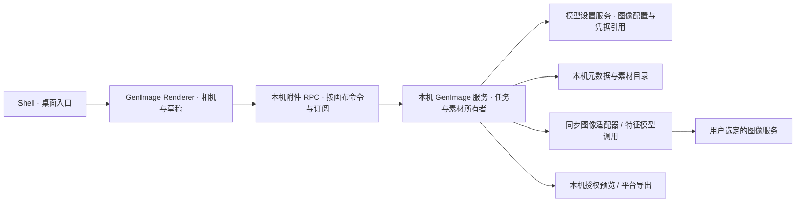
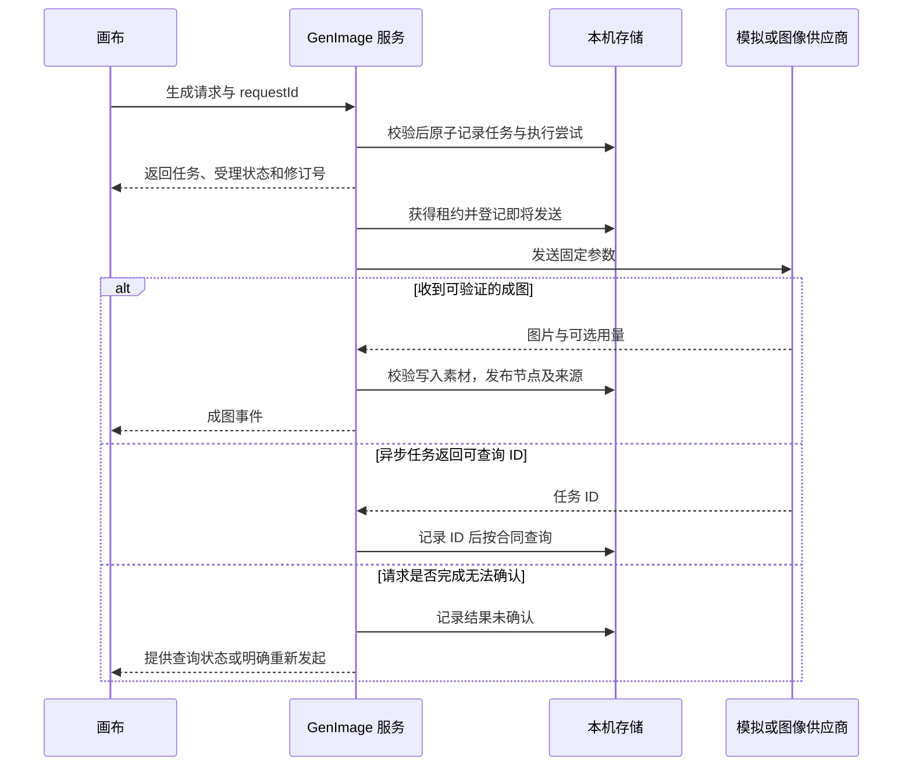

# 图像画布产品与技术设计

2026-11-27 · 当前切片规格与演进路线

当前切片以第 1 节的产品规则为准；旧[本机模拟实施计划](../plans/2026-11-27-genimage-local-canvas.md)仅作为历史记录。后续章节涉及派生、任务队列、事件订阅、归档、异步适配器和聊天联动的内容是演进方向，不构成本次验收。

## 1. 产品定义

「图像」是 ZCode 桌面端内置的图像工作区。本次支持导入素材、创建图像、浏览和导出原图、显式提取图像特征。侧栏入口使用「图像」/「Images」，工作区用「画布」/「Canvas」，动作用「创建图像」/「Create image」，不再使用「生图」作为页面或设置名称。内部路由、RPC 服务标识、测试 ID 和持久化根目录继续使用 `genimage`。

主区域保留现有点阵画布、浮层工具条和拖拽定位。打开时直接读取原真实画布，不再提供模式开关、模拟入口、模拟派生或内置 SVG 示例。旧模拟数据保留在原目录，既不读取、不迁移，也不删除；原真实画布和历史照常恢复。无模型配置时仍可导入、查看及导出。仅本机桌面附件提供这些能力，远程工作区不读写远端文件，普通 Web 和手机远控不开放入口。[原生视图规格](./2026-11-26-genimage-native-view-design.md) · [模型设置规格](./2026-11-26-model-settings-images-and-tools.md)

### 图像素材、特征与预览（2026-11-27）

- 导入是显式操作。首版通过文件选择器选取一个或多个 PNG、JPEG；取消无副作用。Renderer 只移交用户选择的文件字节和文件名，不传本机路径作为读取授权。Host 逐张按实际内容识别、限长并解码，保存原始字节及最长边 240 像素的 PNG 缩略图。原图上限 16 MiB、最长边 4096 像素；现有 500 节点上限保持。单文件失败不留可见节点，不回滚已成功文件，反馈导入成功与失败数量。原文件移动、删除或改写不影响缓存，导出保留格式及字节。
- 画布卡片采用 B 方案：导入素材直接进入画布，不设置独立素材库侧栏。卡片显示缩略图、文件名和最多三个特征标签；完整特征文本在大屏预览的「图像特征」抽屉中按需展示。特征未提取时显示「提取特征」，不在导入或预览时自动调用模型。
- 大屏预览复用仓库现有图片预览的缩放、指针拖动、边界约束、键盘焦点和导出语义。预览默认适应窗口且不裁切，滚轮/按钮以指针为锚点缩放，放大后可拖动；顶部显示文件名、像素尺寸和关闭按钮，底部提供缩放和导出，特征抽屉默认关闭。`Esc` 关闭并将焦点还原到打开预览的卡片。
- 特征提取是显式操作。设备模型设置增加独立且唯一的「特征提取模型」标记，候选必须支持图像及文本输入、文本输出；操作及修订控制与小工具模型一致。卡片或预览显示接收供应商及模型，明确点击「提取特征」才发图。Host 核验该次确认的标记修订和可执行选择，使用现有本地模型调用链发送有界的缓存图像副本，不发送文件名、路径、EXIF 或生成提示词。输出只接收纯文本摘要（最多 600 字符）及 1–8 个短标签（每个最多 32 字符）。UI 以纯文本渲染，不解释模型返回的 HTML 或 Markdown。
- 同一画布内以原图摘要、特征模型标记修订和有效供应商路由为缓存键。相同键并发只允许一个请求；已有结果直接复用。界面显示接收方域名，Host 和 CLI 在派发前核对已确认的有效路由。配置变更后保留历史结果，直到用户显式重新提取后替换；请求错误不覆盖历史结果。中断不自动重放；遇到旧标记修订或有效路由时刷新并让用户重新确认接收方。未配置或不可用时显示前往模型设置的入口，不回退到其他模型。图像字节、供应商原始响应、特征结果和凭据不落业务日志、会话或远端附件。

```text
导入：文件选择 → Renderer 逐张提交字节 → Host 校验、解码 → 短锁发布文件与节点 → 最新画布
提取：确认模型 → Host 核验修订及素材 → 短锁查缓存/占用 → 解锁调用本机模型链
     → 短锁核验操作归属、素材摘要和配置修订 → 持久化结果 → 更新卡片及预览
预览：打开卡片 → Host 核验当前 scope 和原图摘要 → 授权媒体 URL → 本地预览，不请求模型
```

本机 CLI 通过 `workspace/generateText` 的 `genimage_features` 分支接收有界 PNG，不接受混入的提示词、会话消息或工具。使用独立工作区调用，禁用自动重试、模型请求转派和模型正文抓包。stdio 调试记录仅保留该请求和回应的协议元数据。

### 真实同步生成切片（2026-11-27）

「创建图像」只在用户主动提交后调用已保存的默认图像模型；显示接收域名、模型及配置中的尺寸和质量。没有可用配置时保持不可提交，也不在保存设置时试请求。提交时校验用户看到的配置修订；若已变化，先刷新配置，再由用户重新确认。请求范围固定为一次生成一张图：`POST {baseUrl}/v1/images/generations`，请求体只包含 `model`、`prompt`、`n: 1`、可选 `size`、可选 `quality`，兼容 Base64 协议发送 `response_format: "b64_json"`。本阶段只接受 `data[0].b64_json` 中可完整解码的 PNG，最长边 4096 像素，原图最多 16 MiB。保存原始字节并生成有界缩略图，画布使用返回的实际尺寸。

网络失败、额度拒绝、响应格式错误和结果未确认分别显示可操作错误，不能静默降级或自动重试。受理前写入带 `requestId` 的任务，发送后再写入结果或“不确定”状态。重启只恢复已完成素材和未确认任务的提示，不自动重发；同一 `requestId` 同参数可查询/恢复，同一 ID 改参数必须拒绝。网络调用不持有画布素材文件锁。

失败后的原提交按钮复用旧 ID，不会再次发送。另有「发起新请求」操作，确认可能产生额外费用后才清除该草稿的旧请求关联，不自动提交。用户再次点击生成才使用新 ID；原任务记录仍保留。

本阶段不支持真实参考图、多图批量、遮罩编辑、异步 `/v1/tasks` 或聊天联动；这些功能沿用后续扩展路线。真实接口只允许模型设置服务提供的 HTTPS Base URL 和私有密钥，凭据不经过 Renderer、远端工作区或通用凭据 RPC。

```text
打开图像 → Renderer 读取模型投影和画布（不请求供应商）
显式提交 → Host 核对模型修订、读取私有密钥 → 短锁受理 requestId
        → 请求配置的公网 HTTPS 接收方（禁重定向、无重试、无画布锁）
        → Host 验证、解码、生成缩略图 → 短锁发布素材与快照
重开 → 从快照读取已发布图片与未确认计数（不请求供应商）
```

| 方案                                             | 收益                                                     | 代价                                               |
| ------------------------------------------------ | -------------------------------------------------------- | -------------------------------------------------- |
| 从当前视图直接接云端同步接口                     | 最快看到真实图片                                         | 工作区恢复、计费不确定状态和无额度测试仍缺失       |
| 先用正式任务和素材链路接本地模拟，再接真实供应商 | 研发环境重置密钥时仍可完整验收，切换供应商只换执行适配器 | 真实出图晚一个切片                                 |
| 第一阶段同时上线多协议、参考图和批量             | 覆盖较多创作需求                                         | 多种任务语义、上传、成本和恢复规则集中进入一次发布 |

上表为历史方案对比。当前使用已接入的同步生成和离线素材导入，供应商协议用隔离回放验证，不再维护产品模拟适配器。

## 2. 画布与主要交互

```text
┌ 工作区 · 画布名 ▾   ＋ 新生成 ─────────────── 历史  设置 ┐
│                                                         │
│   [A 原图] ───┬──→ [B 夜色]         ┌ 基于此图修改 ───┐ │
│               └──→ [C 清晨]         │ 来源 B · 缩略图 │ │
│                       └─→ [D 待定稿]│ 提示词          │ │
│                                     │ 图像模型 ▾      │ │
│   [－] 100% [＋] [适应画布]          │ 比例     质量   │ │
│                                     │ 发送范围 · 生成 │ │
└─────────────────────────────────────┴─────────────────┴─┘
```

| 入口               | 交互规则                                                                                                                                                                                   |
| ------------------ | ------------------------------------------------------------------------------------------------------------------------------------------------------------------------------------------ |
| 左上角「创建图像」 | 打开图像创作表单。空提示词或模型不可用时给出可操作原因。成功受理后在可见区域生成任务卡；用户可继续平移、查历史和切回聊天。                                                                 |
| 选中图卡           | 图上显示缩略图，下方显示名称、实际尺寸和状态。主要动作是「基于此图修改」，查看详情、复制提示词、导出和归档放入次级菜单。边仅突出当前节点的直接上下游，其他边降权。                         |
| 派生表单           | 来源在打开时绑定，选择其他图卡也保持当前表单来源。点击「更换来源」或从另一张图主动发起派生时，保留正在写的提示词，明确显示新的来源。成功子图放在父图右侧附近空位，避让用户已经整理的卡片。 |
| 拖拽和缩放         | 空白拖拽平移，滚轮以指针为锚缩放，双指支持平移和缩放。拖图只改坐标；拖动结束才提交布局。适应画布考虑浮层遮挡。聚焦历史记录或来源时移动相机，保留正在编辑的提示词。                         |
| 历史               | 先展示当前画布的生成记录，默认按时间倒序。支持完成、运行中、失败及结果未确认筛选。点击成图定位卡片，点击失败记录打开任务详情。首屏分页加载，较早记录按需读取。                             |
| 详情               | 展示已提交的提示词、模型、实际尺寸、质量、来源、时间和错误摘要。「复用参数」只填新草稿。「重新生成」经明确提交创建新任务；如果带来源，继续从原来源派生。                                   |
| 设置               | 显示默认图像生成模型、特征提取模型和当前可用状态，链接到「模型设置」。配置缺失时仍能查看画布、历史和本地素材。                                                                             |

- 宽画布用右侧浮层。窄画布用单一、可滚动的底部浮层。宽度以画布容器为准。保持 `New`、历史、设置与缩放在位置上稳定。面板里复用应用的 `Select`、`Dialog`、按钮和反馈组件。
- 浮层的 `Esc` 优先关闭内层菜单，然后关闭当前面板并恢复触发点焦点。键盘可选择卡片、打开操作、定位父图、查看历史和缩放。预览支持屏幕阅读器和减少动效。任务完成时发出一次低干扰状态通知，焦点、相机和选中图由用户当前操作决定。
- 受理前，表单显示实际输出尺寸。宽高比只是便捷选择项，映射随模型能力而变。模型换了且之前的尺寸不支持时，提示重新选择。编辑表单显示将上传的源图和实际接收方。画布设置中的默认值只用于初始化草稿。
- 草稿按窗口、画布和操作保留，切换图像内外页面时在同窗口恢复。关闭窗口后的草稿恢复可单独加入。已提交任务的提示词与参数独立保存。正式空画布提供「创建图像」和「导入素材」入口，不提供本地模拟入口。

## 3. 工作区、画布和素材谱系

- 建议桌面本地项目按 `workspaceIdentity?.trim() || workspacePath` 隔离。无项目时进入本机「个人画布」。选中远程项目时界面明确显示图像的本机存储归属，用户可以显式进入个人画布。远程文件导入或写回由未来单独授权的工作流处理。第一阶段每个归属一个默认画布，从第一天使用稳定 `boardId`，以后可添加多个命名画布。
- 每次动作用稳定 ID。画布里的图卡是一个有位置的节点，图片是不可变的素材，任务记录一次用户意图及其结果，三者分开。即使两张图的字节相同，节点仍能有不同来源和历史。
- 首版成功子图只有一个主来源。来源为该任务实际传给供应商的素材，并记录对应的画布节点。预留有序的输入列表，未来可标识 `primary`、`reference`、`mask`。同一画布谱系只允许引用已有节点，方向固定为来源指向新节点。图卡拖动、布局和相机均不修改这些关系。
- 首版同一个任务产出一张图。任务受理后可预留一个位置并画虚线指向任务卡。成功时原位替换为图片节点和正式连线。失败仍可从历史查看，画布用任务状态卡明确显示无成图，也可移除状态卡。重试沿用同一用户意图时创建关联的执行记录，重新生成则创建新的用户意图。
- 删除分两步。归档节点时保留素材和谱系，支持恢复，有子图时以「已归档来源」继续定位。清理文件需明确操作，并检查画布、历史和运行任务的引用。缺失原图仍展示历史与可用缩略图，暂停原图导出和派生。

| 记录                | 最小信息                                                                 |
| ------------------- | ------------------------------------------------------------------------ |
| `Board`             | 归属、画布 ID、标题、修订号、时间                                        |
| `Node`              | 画布 ID、节点 ID、素材 ID、创建任务、坐标、归档状态                      |
| `Asset`             | 归属、素材 ID、原图与缩略图内部引用、MIME、宽高、大小、完整性校验        |
| `GenerationJob`     | 画布、操作、来源、提示词、参数快照、预留位置、当前结果                   |
| `GenerationAttempt` | 任务、单次提交 ID、状态、归属租约、上游任务 ID、时间、脱敏错误、结果素材 |

## 4. 状态归属与接口



- Shell 管进入和返回。Renderer 管相机、选中项、浮层、局部草稿及拖动预览。Renderer 通过 hook 调用 GenImage 公共契约，读取修订后的画布投影。
- 本机桌面 Host 执行生图命令。Host 的 GenImage 服务拥有画布、任务、素材和出图状态。当前桌面 Host 按窗口创建。共享同一本机数据的窗口通过持久事务、唯一提交 ID 和执行租约争抢执行权；Main 只提供原生文件对话框和授权媒体访问。
- 图像模型设置继续管理配置和凭据。执行前由 Host 内部接口按配置 ID 解析凭据与能力，提交时持久化非秘密参数快照。正在执行的任务不会因为用户改默认模型而换供应商。待发任务发现连接设置已修改时停在待确认状态，用户检查新的接收方后再提交。
- 建议元数据用 SQLite 事务，原图和缩略图按素材写入应用数据目录。文件先在同盘临时落盘并校验，再用原子发布和索引事务完成成图提交。预留单次执行的存储预算。启动时检查未提交的暂存文件和已索引但缺失的素材，有完整落盘证据就恢复发布，清理无引用孤儿。
- 列表 RPC 发送 ID、状态、尺寸、失败类别和授权预览引用。原图走按需媒体读取或直接从 Host 导出。配置与请求都避免在日志里写入密钥、提示词、原图、完整服务商响应或含敏感信息的 URL。复用仓库已有平台接口和本机授权媒体模式，具体适配在实现切片里验证。 [平台接口](../../../packages/shared/src/platform.ts) · [本机媒体预览](../../../packages/desktop/src/main/localMediaPreviewProtocol.ts)

| 契约草案                                      | 行为                                                                                                                |
| --------------------------------------------- | ------------------------------------------------------------------------------------------------------------------- |
| `getBoard` / `listHistory` / `subscribeBoard` | 读取当前归属快照和有序事件。订阅发现修订缺口时重新拉取快照。历史按游标分页。                                        |
| `startGeneration`                             | 显式接收 `requestId`、画布和模式、图像配置 ID、提示词、参数、来源。校验归属、原图、模型能力和存储空间，再原子受理。 |
| `moveNodes` / `archiveNode`                   | 对应节点版本下修改布局或生命周期。其他窗口只移动其他节点时可合并；同一节点冲突时刷新并提示。                        |
| `stopJob` / `recheckJob` / `retryJob`         | 每个动作按当前状态和适配器能力执行，携带预期版本。切换页面通过订阅恢复查看。                                        |
| `importAsset` / `exportAsset`                 | 导入用原生文件选择或拖放交接，Host 校验内容。导出读取完整原图，用户选择目的地，通过平台保存。                       |

## 5. 任务、失败与恢复



| 状态            | 用户行为与恢复                                                                                                                                   |
| --------------- | ------------------------------------------------------------------------------------------------------------------------------------------------ |
| 待执行          | 首版每本机数据根一个在途付费任务，其他任务排队。发送前取消立即生效。应用重启后确认从未发出的任务显示「待继续」，用户可继续或取消。               |
| 已发送 / 生成中 | 离开画布或切到聊天后继续运行。界面显示耗时。供应商有真实进度时才显示百分比。同步接口的「停止等待」可以中断本地等待，界面说明远端结果可能未确认。 |
| 已完成          | 图片通过校验且元数据发布成功后才标记完成。导出或引用是否可用根据原图重新验证。                                                                   |
| 失败            | 校验、认证、余额、限流、内容拒绝、网络和落盘错误分别给出动作。上游能确认明确失败时可以进入重试流程；已有可用响应暂存时优先重试本地保存。         |
| 结果未确认      | 同步请求发出后超时、断线或 Host 在关键阶段退出时使用。优先查询已持久化的上游任务 ID。无法查询时保留记录，再次提交必须显式确认可能产生额外费用。  |
| 已取消          | 确认未发送，或供应商明确取消时使用。                                                                                                             |

- `requestId` 和完整归一化参数共同确定幂等性。相同 ID 与相同参数返回现有记录，相同 ID 但参数有变化则拒绝。后台记录发送边界，旧租约回调只有仍拥有当前执行权才能写终态。对无法证明未发送的同步任务，窗口切换、重载、重连、租约过期均不触发重发。
- 异步轮询恢复的是原任务查询。保存上游 ID 后可跨重启继续查，使用有限退避与供应商建议的查询间隔。提交时响应丢失且未拿到上游 ID，沿用结果未确认语义。计费与取消按各接口实际合同呈现。
- 测试使用本地图片文件和隔离供应商回放覆盖导入、刷新、断线与导出，不向生产画布发布测试模拟功能。

## 6. 模型适配、输出与成本

| 适配器                    | 可执行操作                             | 设计约束                                                                                                                                                                        |
| ------------------------- | -------------------------------------- | ------------------------------------------------------------------------------------------------------------------------------------------------------------------------------- |
| OpenAI Images             | 文生图；后续开启单图、多参考或遮罩编辑 | 生成走 `/v1/images/generations`，编辑走 `/v1/images/edits`。能力按模型决定，参数由适配器验证。                                                                                  |
| 同步 Base64 兼容接口      | 文生图                                 | 先按已有配置规格固定 `n=1`、白名单字段、解析 `data[].b64_json`。来源图无法通过此协议派生，面板可引导切换到支持的图像模型。                                                      |
| FrostFox 异步任务         | 规划支持纯文生图、参考图编辑           | 用户提供的截图列出 `/v1/tasks`，分别是 `image.generate` 的 JSON 和 `image.edit` 的 multipart。轮询、取消、幂等、状态和结果下载字段在上线前用服务商正式契约及 fixture 单独核实。 |
| OpenAI Responses 图像工具 | 将来如需对话内多轮创作再接入           | 将对话上下文与供应商响应引用保存在该流程中。GenImage 继续用本机素材 ID 表达谱系。                                                                                               |

OpenAI 官方区分 Images 生成、编辑与 Responses 多轮图像工具，且模型支持的尺寸、质量和输入选项不同。适配器投影 `textToImage`、`edit`、`multiReference`、`mask`、可选尺寸和质量、输出类型、状态查询及取消等能力，每次提交以所选配置实际能力为准。透明背景、特殊质量、批量、流式预览按已验证型号开放。 [OpenAI 图像生成指南](https://developers.openai.com/api/docs/guides/image-generation) · [生成接口](https://developers.openai.com/api/reference/resources/images/methods/generate) · [编辑接口](https://developers.openai.com/api/reference/resources/images/methods/edit)

- 首版接受验证过的 PNG、JPEG、WebP 原图。对结果严格校验类型、尺寸、解码像素和字节上限。性能起点可用 32 MiB 原图、1 MiB 缩略和 512 MiB 每画布预算作为预警与验收候选，实际阈值按适配器和基准测试确定。超限时提示清理，并在下一次联网前检查可用空间。
- 用户每次生成前看到接收方、模型、张数和上传来源。按模型可核实的计价信息展示估算及来源，其他情况显示「费用由服务商结算」。额度不足保留草稿与历史。批量功能以后增加时，才开放并发、张数、预算与单项取消策略。
- 每个适配器只使用明确保存的目的地和请求字段。自定义 HTTPS 地址沿用配置校验，网络端补足重定向和目标校验。远程结果下载仅接受适配器已验证的来源，凭据限定在对应 API 请求。优先收内联响应，并限制解码和磁盘使用。显式导出保留真实图片格式与字节。导出副本由用户保存。

## 7. 扩展路线

| 阶段             | 用户可用能力                                                                         | 前置条件和阶段出口                                                                                                             |
| ---------------- | ------------------------------------------------------------------------------------ | ------------------------------------------------------------------------------------------------------------------------------ |
| 1 · 本地闭环     | 素材导入、历史、拖动、重开恢复、查看及导出原图                                       | 无 API Key、断网、重启、双窗口都能验证                                                                                         |
| 2 · 真实文生图   | 从模型设置选图像模型，一次生成一张，支持 OpenAI Images 与现有同步 Base64 配置        | 先做回放验收；随后用明确授权的真实调用验证协议、格式和实际落盘                                                                 |
| 3 · 参考图和精修 | 从已有素材派生、可选多参考和遮罩编辑；支持已核实的异步适配器                         | 单图派生先交付；确认传输范围、可恢复任务 ID、素材版本和遮罩坐标                                                                |
| 4 · 创作整理     | 多命名画布、对比模式、收藏、批量变体、多选导出、提示词模板                           | 较大画布的渲染与分页预算、批量费用与单项重试规则                                                                               |
| 5 · ZCode 联动   | 从聊天把用户明确选中的文本送到画布草稿；把成图添加到有效输入框；经确认把图像写入项目 | 明确目标会话与项目位置。调用现有附件或文件引用入口，由用户发送。远程或移动端先支持只读历史的独立评审，再决定是否允许发起任务。 |

扩展顺序建议先做**并排比较与原图预览**，随后做**参考图编辑和遮罩**。创作者已经可以留下多个方向，再决定是否需要批量。可选的小工具模型用于润色提示词、生成命名和摘要，由各入口明确发起，结果填入用户草稿。没有用户标记时，仅在存在调用方会话的入口沿用当前会话模型。独立画布没有会话上下文时让用户选择，避免默默换到聊天默认模型。

- **比较与版本选择**。多选两张图进入并排视图，共享缩放和定位，可切原图。可将一个节点标为选定稿、复制参数或重新聚焦来源。卡片收藏、名称、排序可以改，生成参数和原始素材的历史记录保持可追溯。
- **参考图与遮罩**。导入图以来源节点进入当前画布，明确排序与主图。遮罩编辑器以原图像素坐标保存草稿，缩放和平移不影响选区。提交时由适配器校验遮罩和源图对齐并转换为供应商格式。结果新增子图，选区外的像素是否可保持由所用接口能力决定。
- **批量与模板**。批量先显示计划生成的任务数、模型和来源，各结果独立完成或重试。受单请求仅一张限制的供应商按多个已确认任务处理。模板只保存提示词和非秘密参数，应用时显示覆盖哪些草稿字段。预设支持显式编辑和更新。
- **跨画布与交接**。多画布中复制素材由用户选择目的地并授权，目的地使用自己的节点。跨项目时保留可公开的来源摘要，避免创建必须跨项目查原图的谱系连线。聊天输入框里的结果仍走已有发送流程。

渲染继续使用 React 图卡和 SVG 连线。先以 500 节点画布作为性能验证样本，视口裁剪、缩略图懒加载、按需绘边及拖动结束提交为第一批优化。只在基准显示 DOM 或解码开销达到瓶颈时评估空间索引、聚合缩略或替换渲染层。文件与任务契约独立于画布渲染引擎。

## 8. 影响范围与验收

影响涉及展示、默认模型、校验、任务提交、持久化和恢复。当前主要入口是 `WorkspaceShellLayout → GenImageView → GenImagePanel`，图像设置来自 `ImageModelSettings → ISpecializedModelSettingsService`。UI 固定入口、服务拥有者、文件发布和任务恢复为必须检查项。共享选图预览、平台保存和图像配置能力为应检查项。聊天附件与远程同步为后续按需进入的边界。聊天模型和 Git 使用的小工具模型配置保持各自的所有权。当前源码和用例按直接调用与一跳相邻边界核对，当前会话未提供可调用的 codegraph。语义图已有模型设置条目；评审通过后可以补入 `GenImage` 画布、任务 owner 和素材边界。

| 用例                   | 验收动作与结果                                                                                                 | 证据                             |
| ---------------------- | -------------------------------------------------------------------------------------------------------------- | -------------------------------- |
| GI-01 · 无额度素材体验 | 无 Key 打开空画布，导入 PNG、JPEG，移动卡片，删除测试源文件后重开恢复。原图导出字节一致；无供应商请求。        | 桌面 E2E、隔离文件 fixture       |
| GI-02 · 来源不串图     | 打开基于 B 的表单，选中 C、拖动节点、回看历史后提交。适配器只收到 B 的原图，D 仍连到 B。                       | 桌面 E2E，适配器回放断言         |
| GI-03 · 一次请求       | 双击或重放命令，双窗口争抢。同 ID 同参一次执行；给同 ID 换提示词被拒。                                         | 回环计数，任务与租约记录         |
| GI-04 · 中断恢复       | 注入发送前取消、发送后断网、进程中止、迟到结果。未发送可继续，结果未知不自动再发，异步已记录 ID 只查询。       | 故障注入，跨重启断言             |
| GI-05 · 模型隔离       | 未配置、无可用模型、尺寸非法或不支持编辑时阻止发送。切聊天模型不会更改生图参数。切默认图像模型不改已受理任务。 | 请求计数与参数快照               |
| GI-06 · 素材隔离与恢复 | 两工作区和两窗口分别读取，验证对归属、导出授权及源图的校验。原图损坏、磁盘写失败时禁止假成功。                 | 隔离文件 fixture，完整性比对     |
| GI-07 · 历史与视图     | 在主题、窄宽、键盘与高密度画布下定位结果，保留草稿。成功完成不会抢走用户焦点。                                 | 桌面 E2E、性能采样与辅助功能验收 |
| GI-08 · 导出与交接     | 导出字节与原图一致。后续验证选择明确会话后仅添加草稿附件，切换目标或取消时可恢复原状态。                       | 平台导出及 composer 专项 E2E     |

本次候选验收：GI-09 验证「图像」直接打开原真实画布、无模拟入口，以及缺少配置只阻止创建图像；GI-10、GI-11 保留既有生成协议、字节、失败和同 ID 不重发验证；GI-12 验证导入损坏文件不写节点且不能跨 scope 读取；GI-13 验证特征标记独立、导入/打开/预览无调用、显式提取一次、同键缓存、重启恢复，旧修订/失败不覆盖结果。桌面回放捕获 OpenAI Chat Completions 的图像输入，检查仅有缩小的 PNG 副本，卡片显示三个标签，全窗详情保留完整结果。GI-14 验证深浅主题下的适应窗口、缩放、拖动、详情、键盘关闭和焦点恢复。用例使用本地图片与隔离回放，不消耗真实额度；执行通过前不标记覆盖。

现有 `GENIMAGE-VIEW` 继续验证纯视图，模型设置既有用例继续验证配置与小工具标记。新增用例按对应阶段验收，供应商使用隔离回放与明确授权的计费冒烟。优先覆盖一次提交、结果未知、跨窗口和素材发布故障。 [原生画布 E2E](../../../packages/desktop/test/e2e/workspace/image-generation/manual-review/pending/genimage-native-view.test.ts) · [模型设置 E2E](../../../packages/desktop/test/e2e/settings/providers/manual-review/pending/specialized-model-settings.test.ts)

## 9. 评审要确认的产品选择

| 讨论项       | 本稿建议                                                      | 影响                                                                                         |
| ------------ | ------------------------------------------------------------- | -------------------------------------------------------------------------------------------- |
| 归属         | 首版每个本地工作区一张默认画布，另有显式个人画布              | 工作区归档与跨项目素材复用以后可分别设计；如果先做全局图库，需提前定义归属、访问和跨项目复制 |
| 真实接口顺序 | 先接 OpenAI Images 与已有同步配置，随后接 FrostFox 异步参考图 | 如果优先验证参考图，异步任务恢复和上传会提前到首轮                                           |
| 导出         | 首版支持导出原图，引用到聊天放到联动阶段                      | 可先闭合素材使用流程，后续再制定会话文件落点及权限                                           |
| 保留策略     | 手动归档和清理，容量先提示，历史模拟文件原样保留              | 可从实际画布规模校准限制，避免清理意外破坏已有谱系                                           |
