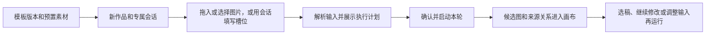
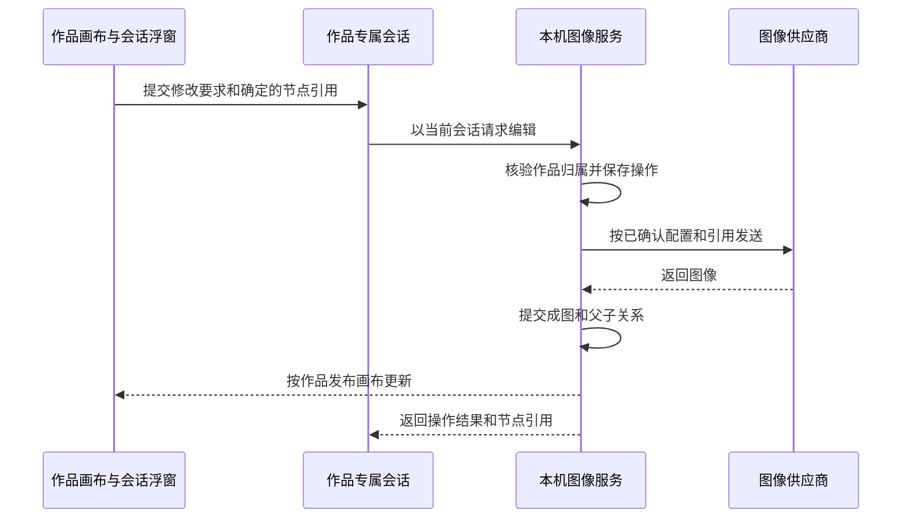

# 图像工作台设计

## 产品范围

「图像」是桌面端独立的创作工作台。用户从「作品」「素材」「模板」进入，在作品画布里完成连续的生成、修改、比较和定稿。作品属于本机图像工作台，通过稳定的 `workId` 识别。切换 ZCode 项目、目录或普通对话时，工作台继续显示同一批作品、素材和模板。

每个作品有一张持久化画布和一个专属会话。会话在画布内以可收起的非模态浮窗展示，使用图像、素材和画布工具。首版的工作台入口和编辑能力面向本机桌面。本文定义从[现有图像画布](./2026-11-27-genimage-canvas-product-design.md)演进的目标，现有原图缓存、预览和模型配置是实现基础。

[详细规格](./2026-11-27-genimage-workbench-detailed-spec.md)定义操作行为、数据契约、模板与图像操作的状态转换，以及逐项验收条件。

## 模块功能

工作台默认展示作品，提供「作品」「素材」「模板」三个入口。作品打开后进入画布，通过「返回作品」回到工作台。作品画布内也能打开本机素材选择器，为当前画布和模板槽位提供同一套素材来源。

### 作品

- **浏览和继续。** 首页显示近期作品。作品卡显示名称、封面、最近活动和正在进行的图像操作。封面优先使用定稿，其次为最近的成图，再用占位图。运行状态从作品的操作记录派生。
- **新建。** 「空白作品」打开空画布及对应的会话浮窗。「从模板新建」打开包含模板简报、所需输入和预置素材的画布。新建和恢复均为本地操作。
- **作品简报。** 用户可持续更新作品目标、要保留的约束和预期交付物。简报持久化在作品中，会话可读取并按用户要求修改。已提交的操作使用提交时固定的参数。
- **组织。** 支持重命名、归档和恢复。归档改变作品在工作台中的可见性，已受理的操作继续写入原作品。再次打开时恢复画布、定稿、模板输入和对应会话。

### 素材

- **导入和收藏。** 在「素材」页导入的文件进入本机素材库。拖入作品画布或模板槽位的文件进入当前作品，可进一步「收藏到素材」。作品里的生成结果同样可以主动收藏。
- **浏览和管理。** 支持缩略图、原图预览、原图导出，以及按文件名或标签查找。特征摘要和标签可以复用现有显式提取流程。查看、搜索和引用本身走本地数据。
- **使用素材。** 从素材库选择一张图，或拖入模板槽位时，界面显示它在当前任务里的角色，例如主体、构图或色彩参考。同一 `assetId` 可以出现在多个作品里，每个画布节点和模板槽位独立持有自己的引用。
- **保留引用。** 移除画布卡片只改变展示，可从历史重新显示。清空槽位和从素材库移除只解除各自的引用。已提交的版本与运行仍能读取固定的图像内容，原图字节的清理以引用检查为准。

### 模板

**模板是一份可运行的创作配方。** 它把适度的预置素材、用户可以填写的输入、要完成的步骤和预期交付组合在一起。用户选的是「怎么做这类图」，例如如何用产品照片做主图，或者如何用一句话生成专题封面。

借用纯函数的类比，**同一模板版本和同一组已解析输入，应展开同一套执行计划**。确定的是素材角色、步骤、依赖和输出约定。真正的图像生成由运行阶段调用模型，重复运行可以得到不同候选。模型调用、存图和会话消息都归本次作品中的运行记录。

```text
模板定义@版本 + 已解析输入 → 执行计划
执行计划 + 已确认模型配置 → 本次运行 → 作品里的候选图与版本记录
```

#### 模板包含什么

- **目标与预览。** 给模板一个可理解的用途、示例和交付物。卡片预览用于选模板，模板定义里明确列出的预置素材才参与执行。
- **基础素材。** 可以包含构图参考、色板、底图或示例风格图。每项有明确用途，界面可见。允许替换的素材表现为带默认值的槽位。
- **输入槽位。** 首版支持图片、文本和枚举。例如「产品原图」为必填图片，「画面主题」为文本，「输出比例」为带默认值的枚举。每个槽位声明角色、必填性和允许的输入。简报与槽位并列显示，方便理解哪些值真正进入计划。
- **流程。** 步骤明确输入来自哪个槽位或前一步结果、需要什么模型能力、会产出什么。首版使用有限的步骤类型和有序流程，模板由产品提供。流程可以组合本地准备、一次或多次已声明的图像调用，以及把结果放入指定的画布位置。可用的步骤以现有适配器能力为准。
- **输出和初始画布。** 明确输出类型、张数、建议比例及候选在画布上的落点。应用时固定模板版本与预置素材引用，后续模板更新只影响之后新建的作品。

#### 用户怎么使用

1. **打开模板。** 点击「使用模板」后新建作品，进入它的画布和专属会话。画布展示预置素材、待填槽位、步骤预览及候选位置，用户可以先整理素材。
2. **提供输入。** 从素材库选择、把图片拖到槽位，或在会话里描述需要的内容。同一个槽位由作品持有一份值，画布和会话都显示当前状态。会话可把明确的描述填成结构化值。指代不清时，显示匹配的候选图让用户选。缺少必填图片时，指出要补的槽位。
3. **启动流程。** 用户可以点击「运行模板」，也可以明确要求会话按模板生成。运行前展示已解析输入、实际会发送的图片、模型和计划调用次数。一次确认覆盖所展示的步骤。更换接收方、发送素材或超出已确认次数时，重新展示待确认的变化。模型不支持指定比例时，执行计划提示调整比例或模型。实际比例以返回的图像为准。
4. **继续作品。** 成图按运行分组进入画布，用户可以从任一候选局部改图、比较或设为定稿。更换槽位后再次运行，会在同一作品创建新的一轮并保留前一轮结果、输入与来源。用户可回到已保存的一轮复用当时的输入。

#### 两种首批模板

- **专题封面。** 主题必填，比例建议 `16:9`，风格参考图可选。用户说「给春季上新做张复古杂志风封面」，会话把「春季上新」和「复古杂志风」填进输入，显示比例和模型。纯文本路线使用现有文生图。有参考图时，使用支持该输入的模型路线。缺少能力时提示可选模型或由用户选择纯文本路线。
- **电商产品主图。** 产品原图必填，背景简报可由一句话填写，构图参考有预置图。用户拉入产品照，输入「暖灰背景，保留瓶身和标签」。先检查来源图及模型能力，再把实际产品图交给参考图编辑步骤，最后把成图放到候选区并连回源图。有标签保留要求时，在对比环节显示原图和成图供检查。

#### 一轮运行怎么记录

作品保存模板版本和可编辑的槽位值。每次启动生成独立的 `runId`，固定本轮槽位、计划、模型配置与授权范围，记录各步骤尝试的 `operationId` 和输入输出节点。绑定发生在本轮提交时。用户随后可以编辑草稿并准备下一轮。

加载模板和预览流程都是本地操作。同一 `runId` 的重复启动读取已受理的那一轮。运行过程中逐步保存进度和已产出的候选。某步明确失败时，保留此前结果，用户可确认从失败步骤继续，并复用已完成的上游产物。若已发出的请求结果未知，保持待核实状态。发起替代请求时显示它是一次新的供应商调用。重开作品时从已持久化的状态恢复查看。



### 画布

- **摆放和预览。** 沿用无限画布的平移、缩放、拖动和原图预览。画布工具条提供导入、选素材、作品简报、模板输入与展开会话。在模板作品中，槽位和结果位置可定位。
- **区分素材、候选和定稿。** 图像节点显示来源和所属运行。派生连接从实际使用的源节点指向结果，移动卡片只更新位置。同一张图可划入后续一轮的不同输入角色。
- **改图和对比。** 从某个节点发起修改，或把它引用到会话。成功后新增版本并保留源图。可选两张图并排查看实际尺寸、来源和相关会话。设定稿更新作品的定稿引用，所有候选仍可继续派生。定稿可导出原图。
- **操作状态。** 画布能看到正在运行、已完成、需处理的操作。历史按本轮运行或时间定位成图；从会话产生的节点可以跳到对应轮次。切换选中项或打开其他作品时，任务结果按提交时的作品和源节点落位。

### 专属会话浮窗

- **打开和续聊。** 浮窗是画布内可收起的非模态面板，展开后画布仍能选择、拖动、缩放和预览。切换作品时随作品恢复会话和输入草稿。收起只改变展示状态，已受理的操作继续执行。
- **引用和指代。** 使用缩略图显示本轮引用的节点与槽位角色，可以移除或更换。在用户提交前展示实际引用。「把第二稿背景再浅一点」以明确的版本选择或确认过的匹配为准。已提交的版本引用与之后的画布选择相互独立。
- **交流、准备和执行。** 用户可询问画布内容、讨论方向、调整简报或填模板参数。当用户要求生成或改图时，会话准备可执行操作，按同一作品命令入口提交。回复展示步骤、结果和需确认事项，点击结果能回到画布。
- **范围。** 专属会话可使用当前作品的画布、素材和图像操作。可读范围由 Host 根据会话绑定裁决，引用到当前作品的素材才作为本轮候选。会话使用的模型和生成图像的模型各有配置。

## 持久化和状态归属

| 数据                                     | 唯一所有者         | 关系和约束                                                                                                                                        |
| ---------------------------------------- | ------------------ | ------------------------------------------------------------------------------------------------------------------------------------------------- |
| 作品、会话绑定、画布快照                 | 本机图像 Host 服务 | 每个 `workId` 绑定一张画布和一个专属 `sessionId`，每个作品会话只属于一个作品。作品索引和归档状态由图像模块投影。                                  |
| 素材和模板                               | 本机图像 Host 服务 | `assetId` 代表可复用的图像文件和元数据。模板应用时保存初始化内容快照，作品按该快照独立演进。                                                      |
| 节点、版本关系和定稿                     | 本机图像 Host 服务 | 节点以 `nodeId` 标识并引用 `assetId`。派生记录实际使用的源节点和操作 ID。节点坐标可以调整，图像内容的变化生成新节点。定稿由作品内的节点引用表达。 |
| 模板运行                                 | 本机图像 Host 服务 | `runId` 固定本轮模板版本、输入、计划和步骤状态。每步引用实际的操作与结果。                                                                        |
| 图像操作                                 | 本机图像 Host 服务 | `operationId` 绑定作品、操作种类、来源节点、模型配置修订和结果。会话触发时记录对应轮次，用于双向定位。                                            |
| 会话正文、轮次、运行状态                 | 现有 Agent 运行时  | 复用会话持久化与恢复。作品会话统一从图像工作台进入。                                                                                              |
| 画布相机、选中节点、浮窗布局、未提交输入 | Renderer           | 按作品隔离界面和草稿状态。是否收起浮窗只影响展示。                                                                                                |

新建作品时，Host 持久化作品记录及预分配的会话 ID。第一次提交前，按这个 ID 确认或创建会话。多个窗口打开同一个作品，或在创建结果未确认后重试，使用同一绑定。现有协议支持指定创建 ID，实际实现须验证创建冲突、首次发送和冷恢复的路径。会话事实继续由现有运行时持有，作品绑定由图像服务持有。 [会话归属原则](./2026-09-09-virtual-project-design.md#35-数据归属)

## 作品会话能力

首版调用面限定在当前作品。读取能力包括作品简报、模板槽位和计划、画布节点、版本关系、定稿和已有特征，并支持对比指定版本。写入能力包括更新简报和槽位、把已授权素材加入画布、运行模板、创建和编辑图像、设置定稿。生成和编辑结果保存到作品，工具响应返回简要结果和节点引用。

Host 从会话身份解析作品绑定，随后逐条校验目标节点、素材引用和操作权限。会话创建、显式恢复及冷恢复都使用同一作品工具配置，运行时确认该配置生效后才接收输入。运行时若需要工作目录，由应用内部装配到托管的图像运行目录。作品的用户数据、输入和工具权限按 `workId` 隔离，工具集仅包含作品能力。

会话模型负责理解要求和调用工具，图像模型负责生成或修改图像，两者沿用各自的配置归属。用户提交涉及上传图像或计费的图像操作时，界面展示目标模型、实际发送的参考图和操作。被确认的操作绑定来源版本和模型配置，后续变更需要重新确认。本机元数据查询、版本对比和定稿可以在图像生成模型未配置时使用。

画布按钮和会话工具调用同一个图像 Host 命令入口。Host 先持久化操作受理，再调用供应商，成功后提交新版本并发布画布变化。同一个操作 ID 重试时查询已有状态。供应商结果未确认时保留待核实状态。再次发起供应商调用需要用户明确确认新操作。普通的会话停止与已发出的供应商请求分别显示实际状态。



## 交付顺序

1. **工作台与持久化作品。** 把侧栏入口切到工作台，支持空白和模板建作品、素材复用、画布保存和重新打开。模板可打开预置画布、填槽并预览解析后的计划。复用现有原图字节、缩略图、预览及导出能力。
2. **专属会话与本地工具。** 完成作品会话绑定、浮窗、图像引用、会话填槽、画布查询、选定稿和双向定位。先用本地数据验证切换作品、重启和多窗口的归属。
3. **运行模板与真实改图。** 将现有文生图接成作品操作，并接入至少一种能接收真实来源图的编辑能力。先跑通支持纯文本启动和要求参考素材的两种模板，再验证从候选继续改图、查看谱系、选定稿和重启恢复。

### 旧画布接入

已有真实画布按可识别的旧范围各导入为一个作品，保留图片字节、坐标、已有来源、特征和历史。旧范围只用于找到数据及记录导入来源。导入记录以旧画布身份去重，提交成功后重复执行返回同一作品。现有目录在迁移验证期间保留，无法识别归属的目录保留原数据供恢复。每个导入作品按新规则建立专属会话，原画布历史继续作为画布历史展示。

## 验收场景

| 场景             | 可验证结果                                                                                                                                                       |
| ---------------- | ---------------------------------------------------------------------------------------------------------------------------------------------------------------- |
| 独立工作台       | 在无项目、切本地项目和切普通任务的场景下打开图像，看到同一套作品、素材和模板。                                                                                   |
| 模板与素材       | 使用同一模板创建两件作品，并引用同一张素材。修改其中一件的简报、布局或引用后，另一件仍可正常编辑和预览该素材。                                                   |
| 模板输入和计划   | 用拖入图片和会话填写相同的槽位。同模板版本和同输入解析成相同的计划。加载、填槽和预览阶段的图像模型请求计数为零。                                                 |
| 文本和参考图启动 | 专题封面使用一句话和模板默认值达到可运行状态。电商主图在产品图缺失时定位必填槽位，补图后计划显示实际参考图和所需能力。                                           |
| 重跑和恢复       | 正在执行的模板运行固定输入与计划。中途换图、更新模板或重启后原运行仍关联原版本。重复启动同一轮不重复发送，启动新一轮时前一轮结果仍可继续编辑。                   |
| 专属会话         | 两个作品各自输入并生成独立对话。切换或重启后再次打开，画布、会话、会话草稿及定稿归属正确。                                                                       |
| 权限与冷恢复     | 创建和冷恢复作品会话后，验证注册工具集仅包含作品能力。用另一作品的节点 ID 发起读取和编辑请求，Host 拒绝且两件作品的数据均未变动。                                |
| 生成与派生       | 用隔离供应商回放生成第一稿，再基于第一稿修改。请求实际包含该来源图。提交后切换所选节点和活动作品，结果仍回到原作品并关联第一稿，同一操作 ID 只发一次供应商请求。 |
| 会话浮窗与定位   | 展开浮窗后仍能移动和缩放画布。收起期间已受理操作正常完成，展开后可从结果定位到成图，也可从成图回到对应会话轮次。                                                 |
| 旧画布接入       | 从存量真实画布导入两次。只创建一个对应作品，坐标和节点关系可恢复，导出字节与导入前一致。                                                                         |
