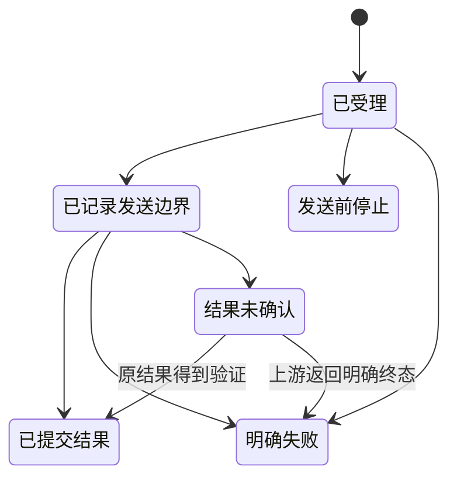

# 图像工作台详细规格

本规格展开已确认的[产品设计](./2026-11-27-genimage-workbench-design.md)，验收编号沿用[实施计划](../plans/2026-11-27-genimage-workbench.md)。文中的记录字段和操作名称定义逻辑契约。原图校验、预览、特征提取及同步文生图继续遵循[现有画布规格](./2026-11-27-genimage-canvas-product-design.md)。

## 1. 产品边界与导航

- 桌面侧栏「图像」打开本机工作台，默认进入「作品」。顶层可切换「作品」「素材」「模板」。打开作品后，主区变为作品画布，通过「返回作品」回到工作台。切换普通会话、当前项目或目录后，再打开图像仍看到同一套本机工作台数据。
- 一个作品从创建到归档、恢复始终有同一张画布和一个会话绑定。画布可在会话尚未创建运行实例时使用。打开作品、预览、提交本地编辑和恢复历史可在图像模型未配置时使用。
- 画布内的会话是可收起的非模态浮窗。它复用对话、流式回复、工具进度和停止体验，工具集限定在图像域。作品会话从作品打开，首版的用户数据以 `workId` 为归属。
- 首版提供内置模板及固定类型的执行步骤。素材库、模板定义和作品均由本机图像 Host 管理。普通 Web 和手机远控沿用现有图像入口限制。

## 2. 作品

### 浏览、新建和恢复

- 作品卡显示名称、封面、最近活动及当前图像操作状态。封面依次取有效定稿、最近的可用成图、占位图。活跃状态以作品操作记录为准。无作品时显示「新建空白作品」「浏览模板」。
- 「新建空白作品」受理后直接打开画布。「使用模板」先固定模板版本和初始内容，再打开新作品。两条入口均写入唯一 `workId` 和预留的 `sessionId`，相同创建请求重复提交会打开同一个作品。
- 作品名称、创作目标、需要保留的约束及交付要求可独立编辑。简报保存后可被会话读取。会话按用户要求修改简报时，使用与界面相同的命令。已受理的图像操作和模板运行使用提交时的参数。
- 「继续」恢复画布内容、模板草稿、定稿和会话。画布相机及浮窗布局是窗口侧的作品偏好。浮窗中的未发送输入沿用会话草稿所有者，按作品会话隔离。
- 重命名只写作品名称。归档将作品移至已归档列表，已受理的操作继续归入该作品。归档作品从归档列表恢复后继续创作。关闭作品和收起浮窗均可再次打开同一画布和会话。

### 多窗口与提交冲突

- 两个窗口可以打开同一作品，各自持有相机、选择和浮窗位置。Host 发布的作品修订单调递增，窗口按 `workId` 接收更新并忽略较旧的快照。
- 修改简报、槽位和定稿时提交所见修订。若改动冲突，保留用户的编辑内容并刷新当前值，由用户确认后再提交。拖动已有节点只校验该节点的位置版本。追加候选使用操作身份和来源归属校验。
- 改变画布选择、打开另一作品或关闭画布都不会重定向已提交的操作。完成结果按受理记录里的 `workId` 发布。

## 3. 素材

### 来源、浏览与引用

- 素材页支持文件选择或拖入导入、按文件名及标签搜索、缩略图列表、原图预览和导出。导入在 Host 中逐张验证。成功的图立即可用，失败的图显示原因，支持单独重选。导入及导出沿用现有格式、尺寸和字节约束。
- 从素材页导入的图显示在本机素材库。直接拖入作品或其模板槽位的图成为作品素材。用户可以将该素材或成图收藏到素材库。打开选择器时，可选素材来自素材库和当前作品。
- 加入画布创建节点。填模板槽位保存槽位引用并在画布上显示该素材的角色。同一图像可在两个作品中引用，也可在一个作品中同时用作主体和构图参考。角色属于引用，原图属于 `assetId`。
- 素材库只搜索已入库的条目。作品会话只能查询作品内已有的图像引用及在本次交互中明确选给该作品的素材。特征提取沿用显式调用及接收方确认。已有摘要和标签可用于显示与搜索。

### 生命周期与字节

- `assetId` 对应不可变的原图及其摘要、实际尺寸和格式。用户可以编辑标签或显示名。用另一张图替换素材会产生新身份，已经使用原图的版本仍指向原字节。
- 从素材库移除只解除素材库引用。从画布移除卡片只移除展示，作品历史可重新显示该版本。清空槽位只改变待提交的槽位值。版本谱系、历史运行、模板默认引用及已受理操作持有的素材继续可读。
- Host 通过作品归属或素材库授权解析图像，再按需发放预览引用或提供导出字节。列表使用缩略图及元数据。原图、可执行路径和凭据由各自所有者保管。

## 4. 模板定义、槽位与计划

### 定义与版本

模板是可运行的创作配方。**同一模板版本与同一组规范化输入展开相同的计划**。计划确定步骤和素材角色。图像调用、产生候选和写入作品发生在运行阶段。

- 一份定义包含 `templateId`、版本、名称、用途、封面、预置素材、创作简报、槽位、步骤、交付描述和初始画布布局。
- 封面示例服务于模板浏览。参与运行的预置素材独立声明其用途、内容摘要和目标槽位。可更换的预置素材表现为槽位默认值。
- 槽位首版支持图片、文本和枚举。每项有稳定的键、标签、角色、必填性和默认值。图片槽位引用已验证的素材。枚举只能取声明的选项。必填文本在去除首尾空白后需要有效内容。
- 每个步骤有稳定的 `stepId`、所需输入、能力及预期输出。首版按声明顺序执行本地准备、文生图或参考图编辑，以及发布候选。步骤可引用前面步骤产出的图像。发布候选使用已完成的图像操作结果，重复执行时定位原节点。
- 应用模板时为作品保存该定义版本、素材引用和初始化快照。后续模板发布新版本时，现有作品及其运行保持使用原版本。空白作品可直接使用画布和会话进行单次图像操作。

### 三种填槽入口

1. 在画布点击空槽位，从本机素材选择器选择。拖入文件时先验证并导入，再绑定槽位。替换成功后，显示实际生效的图及角色。
2. 从作品现有图像选择「用作参考」，再选目标槽位。预览显示被引用的具体版本。
3. 在专属会话中描述目标、风格或比例。会话将清楚的值写入作品草稿。提到某张图时，选择已明确引用的图或展示匹配候选让用户选择。需补图时，会话回复能定位缺失的槽位。

这三条入口写同一份模板草稿。结构化字段显示用户当前可以编辑的值。对话中的补充描述可更新简报或自由文本槽位，保存后才参与模板解析。

### 预览与确认

- 「预览计划」根据固定的模板定义、槽位值和预置素材解析步骤。计划中引用槽位和素材内容身份，具体画布 `nodeId` 在当前作品绑定，时间和临时显示状态不参与计划计算。等价输入可在不同作品中得到相同的步骤和素材角色。
- 预览显示缺失项、实际参与的图、处理步骤和预计产出。已有参考图时，计划将其作为输入；可安全走纯文本的模板可以由用户主动移除参考图、重算计划。参考图编辑所需能力缺失时，提示调整模型或参考图配置。
- 界面点击「运行模板」和会话显式要求运行汇合到同一确认。确认显示实际接收方、模型、发送内容和计划调用次数。一次确认覆盖展示的步骤。改变接收方、发送素材或调用次数需更新预览和确认。
- Host 在受理时复核计划、素材摘要及模型配置版本。已确认的首选模型无法继续使用时，运行卡展示原因及可选动作。已开始的运行继续使用已受理的输入快照，随后改槽位形成下一轮草稿。

### 首批内置模板

**专题封面**。输入为必填主题、可选风格描述、建议 `16:9` 的比例和可选风格图。用「给春季上新做张复古杂志风封面」即可填主题和风格。默认路线是整理主题与风格、调用一次文生图、发布一张封面候选。存在风格图时，改走具备参考图能力的路线。计划按模型实际支持的输出设置确认比例。

**电商产品主图**。输入为必填产品原图、背景描述、带默认值的构图参考和输出比例。准备步骤固定产品图与相应的参考图角色，执行一步真实参考图编辑，然后发布一张候选并建立来源关系。会话可读「保留瓶身和标签」的约束，结果预览可打开原图和成图对比。

## 5. 画布和定稿

- 画布沿用平移、缩放、拖动和原图预览。常驻入口包括导入、素材选择、模板输入、会话和历史。模板作品在可定位区域展示待填槽位和候选落点。用户移动节点后保存位置，结果回流时保留已经整理的布局。
- 卡片显示图像、来源及所属运行。历史按时间或运行定位候选。图像编辑后的结果新增节点，关联真实用于该次调用的源节点。仅作为文字背景提及的图可出现在对话，谱系只记录实际参与图像操作的图。
- 首版比较支持选两张图并排预览，可查看真实像素尺寸、来源、生成提示及相关轮次。从对比中可以选用任一版本作为下一次编辑来源，或设为定稿。
- 设置或更换定稿只更新作品的定稿引用。原候选及派生关系继续可用。导出支持选中图或定稿，保留原图格式及字节。模型未配置时，画布可继续导入、预览、比较、定稿和导出。
- 键盘能进入或离开浮窗，画布仍可操作。预览、素材选择器和确认弹层关闭后恢复触发点焦点。窄窗口时浮窗约束在可见范围，保留收起控制和画布工具入口。配色及控件沿用 ZCode 主题。

## 6. 专属会话与权限

- 创建作品时预留稳定 `sessionId`，首次提交前经 Host 幂等确认或创建持久会话。对重复进场、多窗口创建和丢确认重试使用同一绑定。会话的正文、轮次、草稿与运行由现有会话设施管理，作品与会话的绑定由图像 Host 管理。
- 作品入口、显式恢复及冷恢复使用同一个图像工具配置。Host 通过可信连接和实际会话身份解析 `workId`，运行时在确认配置生效后接受输入。协议版本不能落实配置时，显示会话不可用原因，画布本地功能仍可用。需要执行目录时使用应用托管的图像目录。
- 会话可读简报、槽位、计划、节点、运行与已有特征。可按用户指令编辑简报或槽位、加入已授权素材、比较、定稿以及准备或发起图像操作。终端、通用文件读写与外部工具均在图像工具集之外。工具执行以 Host 查到的作品身份为准。
- 输入框用缩略图和角色标签展示本轮明确引用的节点。提交时固定引用。会话中的「这张图」「第二稿」只有在明确定位后才可触发相应操作。用户点击结果卡定位画布节点，画布卡片也可以定位产生它的会话轮次。
- 模板运行及图像操作通过与画布相同的图像命令受理。会话记录保存工具摘要和节点引用。会话模型与图像模型分别使用各自的配置，按用户确认的范围读取或发送实际图像。

## 7. 运行状态与恢复

### 模板运行状态

一轮模板运行由 `runId` 标识，记录固定计划和各步骤进度。一次图像调用由 `operationId` 标识，记录是否已发送及其结果。画布直接生成或编辑也使用图像操作记录。有模板上下文时再关联 `runId` 和 `stepId`。

- **已受理。** 保存 `workId`、模板版本、输入和来源摘要、计划及确认范围。同一 `runId` 的重复提交查询当前状态。
- **运行中。** 前置步骤完成且确认范围有效时，开始下一步。进度显示步骤名称、已完成步数及已可查看的候选。
- **需处理。** 缺少可用模型、配置变化、明确失败或结果未确认时，显示对应原因和允许的动作。用户继续时沿用本轮已经提交的结果，从当前步骤恢复。若当前步骤缺少已核实的结果，重新调用使用新尝试并保留原记录。
- **已完成。** 计划中的产出已提交，可比较、定稿或以其中任意一张继续编辑。修改槽位后再次运行创建新一轮。
- **已停止。** 暂停启动后续步骤，显示已发请求的实际状态。用户可以明确继续，恢复点仍取本轮已提交的步骤。当前步骤结果未确认时遵循其操作状态。会话停止和图像供应商取消分别展示。

### 单次图像操作状态

- **步骤已受理。** 在准备调用供应商前保存 `operationId`、参数指纹和源节点。在持久化发送边界后才调用供应商。同一 ID 与同参数查询已有操作，参数变化返回冲突。
- **成功。** 校验并保存原图与缩略图，原子提交操作成功与结果节点，再通知画布和会话。已经可验证的暂存结果可用于恢复本地发布。供下一步使用的输出以已提交节点为准。
- **明确失败。** 保存具体原因及已成功步骤。用户可以修复条件后继续失败步骤，保留已完成的图，新的尝试拥有新的 `operationId`。
- **结果未确认。** 发送后失去响应且无法确认结果时，保留操作记录并显示待核实。重开、切换作品和同 ID 重试只恢复状态。若随后能通过受支持的查询或可验证的原结果确认，则更新原操作。发起替代调用时显示新的请求范围和可能的费用。
- **停止。** 发送前可以停止。供应商支持取消时显示其确认结果，已完成或迟到的有效结果仍归原操作和作品。发送后请求状态取实际结果或取消确认。

图中的状态对应一个图像操作 ID。继续失败步骤或发起替代调用，形成新的尝试记录。进程恢复时先对账已提交结果、可验证暂存结果及发送边界。恢复页面只读取这些状态，后续执行遵循原确认范围与明确的继续操作。

## 8. 逻辑数据与命令契约

- **作品 `Work`。** `workId`、作品修订、名称、简报、生命周期、画布节点、定稿节点、会话绑定和可选模板实例。作品卡从作品及操作记录投影。
- **素材 `Asset` 与节点 `Node`。** 素材持有 `assetId`、原图摘要、媒体类型、尺寸和可选特征。节点持有 `nodeId`、`workId`、`assetId`、位置与位置版本、来源和关联操作。派生关系限于同一作品，素材可通过授权供多个作品使用。
- **模板与实例。** `templateId` 和版本确定定义。实例持有该版本和可编辑槽位，模板版本及预置素材摘要固定。计划是根据规范化输入计算的投影。
- **运行 `TemplateRun`。** `runId`、所属作品、输入快照、计划、确认范围、当前进度及步骤尝试引用。步骤对结果的引用只指向本作品已提交的节点。
- **图像操作 `ImageOperation`。** `operationId`、所属作品、可选运行和步骤、输入与模型配置快照、发送状态、可选结果节点及会话轮次。保存可显示的模型身份和参数，凭据继续由模型设置服务持有。

### 逻辑接口

- **作品请求。** 创建携带 `requestId` 及可选模板版本，返回作品摘要与当前修订。读取携带 `workId`，返回画布、模板草稿、定稿与操作状态。新建、导入和已提交操作的 ID 在重试时保留。
- **作品编辑。** 简报、槽位及定稿更新携带 `workId`、目标字段与预期修订。节点移动携带 `nodeId`、坐标与位置版本。更新成功返回新的修订，冲突返回可用于重新确认的当前值。
- **计划与确认。** 预览返回解析出的步骤、实际素材引用、预期产出及阻塞原因。准备运行时解析供确认使用的模型与调用范围。提交绑定 `workId`、`runId`、解析计划与该次确认。Host 在接受前核对已确认的内容与实际执行条件。
- **图像操作。** 单次生成、修改或模板步骤提交携带 `operationId`、所属作品、来源节点及已确认的模型配置。模板步骤还需指明 `runId` 与 `stepId`。返回已有或新受理状态，最终结果按作品更新。
- **变更通知。** UI 按 `workId` 加载快照并订阅变化。收到新的作品修订时更新视图，订阅重连或检测到缺失的变更时刷新相应快照。会话、画布和工作台使用同一份 Host 结果。

模板草稿与运行记录各自只有一个写入源。对网络请求使用操作 ID 去重，文件锁只围绕受理与提交，网络等待期间释放。作品数据保存在现有本机图像数据根目录的独立工作台区，多个窗口经同一逻辑存储约束读写。

预览、读取和导出先核对作品或素材库引用；已归档、缺失或损坏的结果仍能按其历史状态展示。界面使用可处理的原因区分缺输入、能力不可用、配置变化、请求冲突、明确失败和结果未确认。

## 9. 旧画布接入

1. Host 从已知的旧个人范围及可定位的本地范围查找真实画布。以源画布的稳定身份生成导入去重记录。旧范围仅用于找到数据及标明导入来源。
2. 逐项校验原图、缩略图和清单。可用条目保留原字节、坐标、历史、来源关系及特征。遇到缺失原图的旧条目，保留其历史并显示素材不可用。准备好的作品获得独立 `workId` 和预留会话 ID。
3. 完成提交后显示作品。重复导入、重启或中断后再次尝试，返回同一个已导入的作品或继续尚未提交的迁移。无法定位的旧数据及迁移源目录保留。导入作品的旧图历史显示在画布，新会话从首次使用开始。

## 10. 验收闭环

- **IWB-01 作品。** 从无模型状态创建两件作品，分别修改简报及归档、恢复。切换项目或普通任务，再回来看到同一作品列表。来自两个窗口的冲突编辑保留各自草稿并显示冲突。
- **IWB-02 素材。** 同一素材用于两件作品及两个角色。移除库引用、一个卡片或一个槽位后，另一作品、历史及已确认运行仍读到固定原图。可用版本导出字节一致。
- **IWB-03 旧画布。** 用旧清单和原图中断后重试，重启并重复导入。只形成一个对应作品，坐标、关系、原图或缺图状态保留。
- **IWB-04 模板。** 同一组输入通过界面和会话填入相同槽位。等价计划一致。缺必填图、模型能力缺失和比例不支持分别有可操作定位，浏览、填槽与预览期间图像模型请求数为零。
- **IWB-05 会话。** 创建、重开、冷恢复和丢确认重试均使用原绑定。另一个作品的节点读取及改图被拒绝，运行时实际工具集限定为图像能力。普通会话同时使用时不串草稿、引用或工具配置。
- **IWB-06 浮窗和定位。** 展开时能用画布，收起时已受理的操作继续。引用 chip 和会话填槽反映实际输入，可以从会话结果定位候选，并从候选回到原轮次。
- **IWB-07 执行。** 一句话完成封面计划，拖入产品照完成主图计划。回放断言发送的具体字节、角色、模型和次数。运行时切换作品、版本与槽位，迟到的结果仍归原作品和实际来源。
- **IWB-08 重跑和恢复。** 第一阶段成图后让下一步明确失败或返回未确认。继续时复用上游图，重复原请求只查询。同模板换输入启动新一轮后，可从旧候选定稿。重启后两轮保留各自的输入、尝试及谱系。
