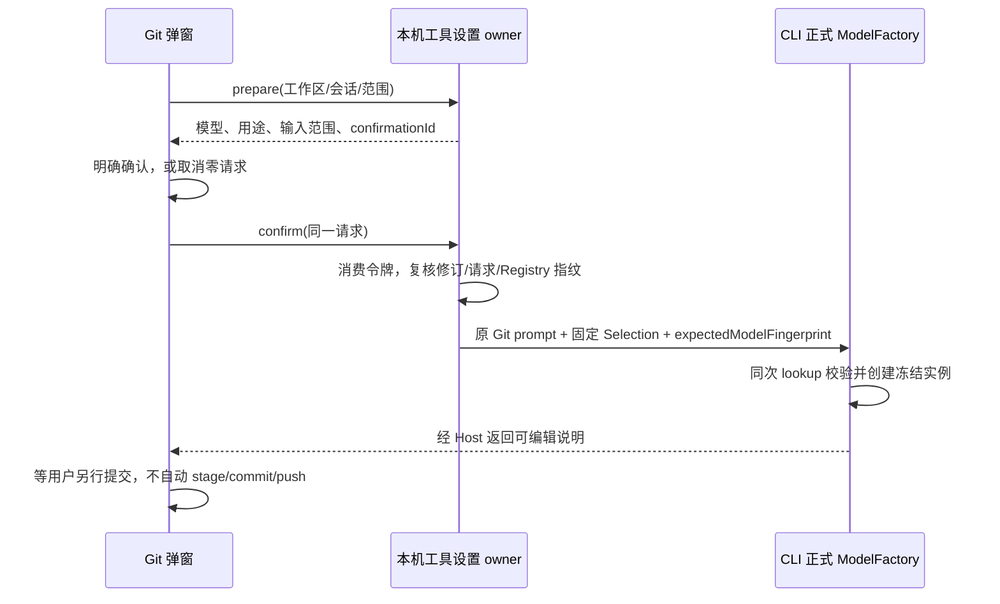

# 本机小工具模型设置

日期：2026-11-25。依据批准设计 `../superpowers/specs/2026-11-25-builtin-image-generation-model-settings-design.md` §6。

## 范围与所有者

- 工具绑定由本机专用 `tool-model-settings` 服务保存到独立配置文件；不写聊天默认、会话选型或通用 AppSettings。当前可交付工具为 `git-commit-message`。
- 设置入口和服务只存在于本机 Desktop base attachment。Web、手机、Source settings 和远端 workspace 不发布该服务；普通 Git RPC 不读取工具绑定。
- UI 经 hook 读取服务，仅保存草稿/反馈。候选来自本机正式 Registry，要求启用、已授权、可选且可输出文本；持久引用失效时保留待修复状态，不自动改选。
- 自动标题必须有当次命令的可信本机 Desktop 来源。会话 `clientMode` 不等于实际输入来源；来源未贯穿会话、目标和延后标题入队前，不展示该工具绑定。CLI 原显式选型、闲时票据、CAS 和兜底不变。
- 当前生产唯一 GitActionMenu 调用位于 ConversationStatusPanel，未传 conversationContext；本次保持文件/diff-only，不隐式读取或外发 transcript。确认明确写“不附加会话正文”，并展示本次已暂存/包含未暂存的冻结范围。未来显式调用者提供上下文时才展示和发送该部分。

## 接口与确认

`getView()` 返回修订、候选和每行绑定/可用状态。`saveBinding({toolId, expectedRevision, selection})` 使用跨进程文件锁与 CAS 原子保存；null 恢复默认，冲突不丢 UI 草稿。保存与读取均不发模型请求。

`prepareGitGeneration(request)` 仅准备显式绑定：请求携带显式 sessionId、sessionWorkspacePath、Git cwd 与 remoteSessionId；Host 用 tasks-index 校验本机 session 所属工作区和 worktree cwd。返回一次性 confirmationId、供应商/模型、工具修订和实际输入范围。Host 在确认前读取有界文件摘要/diff，冻结正式生成 prompt；确认时重算只读快照以检测变化，不匹配零请求，发送仍使用准备的原快照。不绑定时返回 default，由调用方走原 Git 服务。显式失效返回 model-unavailable，不落回默认。

`confirmGitGeneration({confirmationId, request})` 比较同一完整规范化请求（本机 workspace、会话 ID、文件范围、语言及上下文）、绑定修订和正式模型指纹。任一变化返回 reconfirm-required，零上游请求；确认令牌单次消费，重放不重发。页面不持久化令牌，取消不调用确认。

正式接入方/模型配置的 SHA-256 指纹只在 Host 内准备，随内部 workspace/generateText 下发。CLI 的正式 ModelFactory 在同次 Registry lookup 中比较指纹，再由同一 Provider/Model 配置创建冻结实例；不把 Host 的 revision 当作 CLI revision。之后 Registry 更新不切换已创建实例。指纹不含可逆配置，密钥和原始接入配置不进入 RPC 回执、日志或错误。

## 验收

- TM01：设置不同 Git 模型后重开，候选/绑定持久；聊天默认原值；恢复默认。
- TM02：生成明确展示目标及 diff/已有会话上下文范围，取消保留输入且零请求；确认只回填草稿。
- TM03：空说明提交/提交并推送在覆盖下确认并回填后停止；用户再次提交才产生 Git 写入。
- TM04：确认前修改绑定/接入方/模型、替换上下文或工作区、重放令牌均零请求，显示重新确认并保留弹窗。
- TM05：失效引用保留待修复，无默认静默外发；Web/手机/远端仍用原规则。
- TM06：CLI 回归证明错误指纹创建零 Model，匹配时使用同次解析实例，原无指纹调用兼容。
- TM07：自动标题行在实际触发来源不能完整证明时不存在；现有标题/闲时选型不回归。
