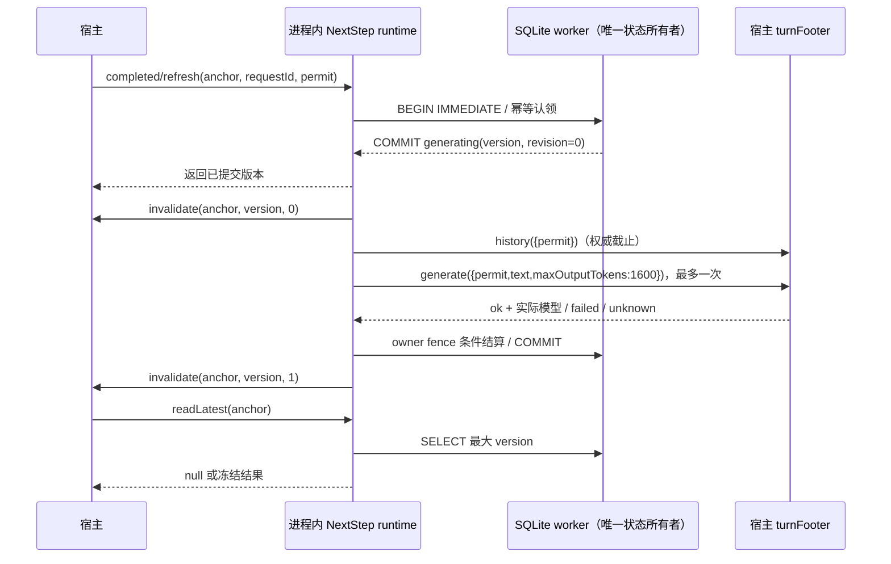

# NextStep 插件实现规格

本目录实现既有 `docs/superpowers/specs/2026-11-20-nextstep-turn-footer-design.md` 的插件部分，以本次冻结的 1.5.0 契约为准。宿主接线、渲染和点击发送均不属于本目录。插件不发聊天消息，不访问网络、凭据或会话数据库。

## 契约与状态所有者

- 清单入口 `./index.mjs`，`onAvailable` 激活，注册 `nextstep`。声明 `sessions.read`、`turnFooter.generate` 与协议 `sessions: 1, rows: 4`。
- 命令通过 `call.args` 接收 `readLatest | completed | refresh`；严格校验冻结锚点及 requestId/permit，不增加返回字段。
- 唯一权威存储为 `ctx.extension.dataPath/nextstep.sqlite`。异步 worker 执行 `node:sqlite`，事务分配版本，revision 从 0 的 generating 结算到 1 的终态。数据库只存锚点、请求收据、触发类型、执行者、状态、时间、实际模型、建议和固定非敏感错误码。
- `readLatest` 只读版本最大记录，绝不读取历史或调用模型。失败和 unknown 均作为最新记录保留，不回退到旧 ready。已结算记录不可变：ready 记录原样返回持久化 items，包括排序规则收紧前（0.1.0）保存的 5 条旧版本，不重新排序或截取。
- 自动完成仅在锚点没有任何版本时认领。手动刷新追加版本。同锚点仅一个 generating；每个 `(anchor, requestId)` 收据绑定首次返回的版本，包括在途合并请求，防止迟到重投新增调用。
- worker 开启数据库时更换执行代际 owner fence，将失去执行者的 generating 结算 unknown，不接管、不重发。每次新认领有独立 UUID；结算必须同时匹配执行代际 owner、claim UUID、anchor、version 和 generating。schema 使用 user_version=1；未知的较新 schema 拒绝打开，不破坏数据。
- 宿主保证全 App 单例扩展进程。同一进程按真实 dataPath 共享存储协调，但实际 `deactivate/reload` 会立即隔离旧执行代际：同步禁止后续 history/generate 调用，事务更换 owner 并将该代际 generating 结算 unknown，发布结算通知后关闭 worker。等待中的 history 返回后不调用模型；已发出的模型结果迟到时丢弃，不覆写新版本、不重放请求。
- 编辑器卸载、切换会话不是插件 deactivate；它们只按锚点读取，已认领任务继续在插件进程后台执行。插件停用和 App 退出则按上述执行代际收口；进程崩溃由下次激活恢复 unknown。

## 生成与结果验证

- 只使用 `history({permit})` 返回的 user/assistant 文本，不按当前焦点重新取历史。校验最多 40 条、总文本不超过 24000。没有用户任务或结尾助手回答时结算 empty。
- 提示词包含最新用户任务、最终回答和剩余预算内的前序消息，序列化后总长不超过 24000。文本只在内存中使用；不持久化原始历史、生成请求、permit 或模型原始输出。
- 要求模型只返回 JSON 对象 `{ "items": [{ "dimension", "label", "prompt" }] }`，提示词只要求 2–4 个不同维度。显式空数组为 empty。原始候选继续接受 2–5 条：非法 JSON、根结构、超过 5 条原始候选或只有 1 条均失败，不做修复调用。
- 局部候选验收：在原始候选中逐项严格校验字段、纯文本长度和非空值，按 trim/lowercase 去重维度；无效或重复项可被丢弃。存活的候选按概述 Unicode 码点数（`Array.from(label.trim()).length`）升序稳定排序，同长保持原始顺序；排序后截取前 4 条，最终 2–4 条为 ready，存活不足 2 条 failed。长度上限分别为 60/100/4000，拒绝额外行为字段。排序与截取只发生在新生成结算时，不触发修复或第二次模型调用。
- ID 由插件为已接受项确定性分配（锚点、版本与内容的 SHA-256，公式与 0.1.0 完全一致），不信任模型 ID；同一持久版本反复读取和重开保持一致。仅 ready 返回 items。
- ok 响应记录实际 providerId/modelId，包括输出校验失败或 empty；失败只保存插件固定错误码。history 失败为 failed；发出 generate 后抛错或响应损坏为 unknown；不重试。
- invalidate 在认领和结算提交后异步发布，不等待端口响应；通知卡住或失败不阻塞生成、不回滚、不补发生成，重新读取仍得到持久事实。

## 可重复验证

`node --test plugins/nextstep/test/*.test.mjs` 使用真实 SQLite 和受控宿主端口，不使用网络。覆盖手动/自动竞争、在途合并的重投、重开最新失败、稳定 ID、局部候选验收、码点排序（含 emoji 与同长并列）与 5→4 截取、旧版 5 条记录原样读取、提示词 2–4 数量约束、非法输出、预算与权威历史、模块换代、崩溃恢复、owner fence、隔离和输入校验。

使用本机现有 Electron 的 Node 模式执行相同测试和 SQLite 探针。市场只更新本地清单并保留无关条目；不注册、不安装、不启用插件。

## 集成边界

宿主与渲染器接线位于主仓库，所需扩展 API 为 1.5.0。桌面端到端回放仍待验证；本地端口和 SQLite 测试不代替桌面联调。市场注册、插件安装和实际模型试用均未执行。
